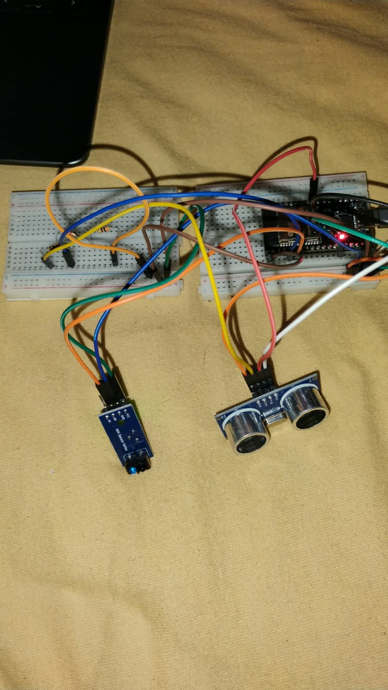
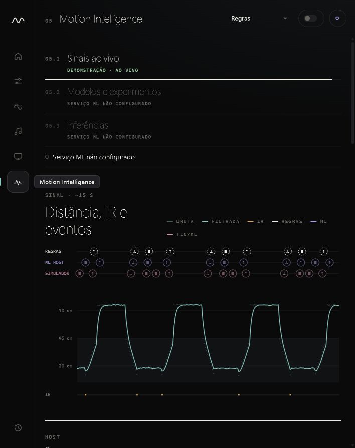

# MotionLab

### Sistema de Interação Gestual com ESP32 e Aprendizado de Máquina

O MotionLab é um sistema embarcado e uma interface local para experimentar interações por gestos. Uma ESP32 coleta distância e presença; o notebook recebe as leituras, reconhece padrões e apresenta controles, experimentos visuais, música e informações sobre os modelos.

O protótipo combina um sensor ultrassônico HC-SR04 e um sensor infravermelho TCRT5000 para transformar a aproximação da mão em interações com a interface MotionLab. O notebook recebe as leituras por USB e usa regras ou modelos de aprendizado de máquina para reconhecer gestos. Uma conexão opcional por Wi-Fi e MQTT foi exercitada com a placa; após ajustes, um teste curto no ritmo padrão não apresentou novos descartes.

O projeto investiga como transformar sinais de sensores simples em comandos úteis, separando a implementação de software da evidência necessária para avaliar seu desempenho com pessoas e hardware real. Surgiu como ChickenLittle, evoluiu para MotionPet e mantém a experiência anterior em `/legacy/`.

## Demonstração

Execute a interface em modo de demonstração e abra [127.0.0.1:8767](http://127.0.0.1:8767/). A origem DEMO usa dados simulados e é identificada na interface.

```powershell
.\.venv\Scripts\python.exe -m terminal.web --demo
```

### Montagem física



Foto fornecida pelo grupo: ESP32, duas protoboards, HC-SR04 e TCRT5000. Outras vistas mostram as [placas e o divisor](docs/fotos-bancada/placas-e-divisor.jpg), o [detalhe do divisor](docs/fotos-bancada/detalhe-divisor.jpg) e a [ESP32](docs/fotos-bancada/detalhe-esp32.jpg). As fotos documentam a montagem, mas não comprovam todas as conexões ou a operação elétrica.

### Interface em demonstração



As capturas mostram [Início](docs/capturas-motionlab/01-inicio-demo.jpg), [sinais ao vivo](docs/capturas-motionlab/02-sinais-demo.jpg) e [Motion Canvas](docs/capturas-motionlab/03-canvas-demo.jpg), executados em modo **DEMO** com dados simulados. A origem está identificada nas telas.

## Funcionalidades

- **Motion Control:** perfis associam gestos a ações internas ou a teclas de um catálogo limitado. Ações no sistema começam desativadas e dependem de habilitação explícita.
- **Motion Canvas e Air Music:** animações e sons respondem à distância; o sensor IR também oferece interações discretas.
- **Air Slides:** apresentação integrada ou envio de teclas para a janela em foco.
- **Motion Intelligence:** sinais, comparação de reconhecedores, coleta e resultados de inferência e avaliação, com indicação de origem e disponibilidade.

As regras são a fonte padrão dos gestos. O modelo no host e o TinyML embarcado são selecionáveis; os modelos existentes foram treinados com dados sintéticos. A experiência legada inclui o pet e o jogo Pet Launch.

## Arquitetura

```text
HC-SR04 + TCRT5000
        │
        ▼
ESP32 / FreeRTOS ── USB · JSON Lines v1 ──► aplicação local ──► MotionLab no navegador
        │                                      │
        ├── TinyML                             └── regras / ML no host
        └── Wi-Fi · MQTT opcional ──► ingestão e API de inferência

simulação ──► MQTT ──► persistência ──► Airflow ──► experimento / MLflow ──► API
```

O caminho serial é a interface local da bancada. O transporte IoT opcional foi exercitado com a ESP32 por Wi-Fi e MQTT/TLS até a persistência das amostras, com limites registrados no [ensaio de bancada](docs/motionlab_bancada_iot_2026-11-12.md). O fluxo inferior foi demonstrado com dados simulados, incluindo uma execução em lote do DAG real do Airflow. A execução contínua do scheduler e o desempenho físico dos gestos não são comprovados por essa demonstração. Consulte a [arquitetura](docs/motionlab_arquitetura.md), a [Fase C](docs/motionlab_fase_c.md) e a [Fase E](docs/motionlab_fase_e.md).

## Hardware

A montagem atual usa ESP32 DevKit, HC-SR04, TCRT5000, resistores, protoboards e conexão USB. O ECHO de 5 V do HC-SR04 chega à ESP32 por um divisor resistivo; o TCRT5000 opera em 3,3 V. O LCD usado em versões anteriores está fora da montagem. As leituras simultâneas dos dois sensores foram relatadas na bancada, sem medições de precisão ou validação física completa.

Consulte as [ligações vigentes](docs/bench_verified_wiring.md), o [diagrama Wokwi atual](hardware/wokwi/montagem_atual/diagram.json) e as [restrições elétricas](docs/hardware_safety.md) antes de alterar a montagem.

## Tecnologias

Firmware em C++ com Arduino, FreeRTOS e PlatformIO; aplicação local em Python, HTML, CSS e JavaScript; processamento e modelos com NumPy e scikit-learn; MQTT, Airflow e MLflow na infraestrutura de experimentos. O navegador usa Canvas 2D e Web Audio para as experiências interativas.

## Instalação e execução

Os exemplos usam PowerShell no Windows, Python 3.11 ou superior e `uv`. Crie um ambiente virtual e instale as dependências do projeto; para experimentos de ML/MLOps, instale também as dependências descritas no [ambiente de ML/MLOps](docs/motionlab_mlops.md#ambiente-local-reproduzível).

```powershell
uv venv .venv --python 3.13
uv pip install --python .venv/Scripts/python.exe -r requirements.txt
.\.venv\Scripts\python.exe -m terminal.web --demo
```

Abra [http://127.0.0.1:8767/](http://127.0.0.1:8767/) e escolha DEMO. Para usar a placa, inicie sem `--demo`, selecione a porta serial na interface e mantenha apenas um programa conectado a ela. A interface anterior está em [127.0.0.1:8767/legacy/](http://127.0.0.1:8767/legacy/).

## Execução completa com Docker

Um único comando, na raiz do repositório, sobe broker MQTT, simulador do sistema embarcado, ingestão, Airflow, MLflow, API de inferência e dashboard:

```powershell
docker compose up --build
```

Dashboard em [127.0.0.1:8767](http://127.0.0.1:8767/), API em [127.0.0.1:8768](http://127.0.0.1:8768/health) e MLflow em [127.0.0.1:5000](http://127.0.0.1:5000/). A interface do Airflow é opcional: `docker compose --profile console up --build`. A correspondência entre a especificação de Aprendizado de Máquina e o repositório está em [docs/aprendizado_maquina.md](docs/aprendizado_maquina.md).

## Treinamento e avaliação

O experimento separa grupos de desenvolvimento e teste, compara modelos e registra origem, configuração e artefatos. Após instalar as dependências de ML/MLOps, o exemplo abaixo gera um corpus **sintético** e executa o fluxo isolado, sem escrever no firmware. Gere o corpus apenas se o diretório de destino ainda não contiver arquivos que precise preservar:

```powershell
.\.venv\Scripts\python.exe -m ml.collection --generate-synthetic-corpus --output-dir data/raw/synthetic
.\.venv\Scripts\python.exe -m ml.experiment --raw-dir data/raw/synthetic --cohort synthetic --extended-models --learned-baseline --search grid --leave-one-group-out --tune
```

As opções comparam também KNN, AdaBoost e um baseline aprendido, fazem Grid Search de hiperparâmetros com validação agrupada e rodam LeaveOneGroupOut. Os resultados ficam em `data/experiments/synthetic/`, ignorado pelo Git. Dependências adicionais, validação cruzada, rastreamento MLflow, exportação e limites metodológicos estão na [documentação de ML/MLOps](docs/motionlab_mlops.md#experimento-completo-sem-hardware). Esses resultados descrevem o cenário sintético; não medem generalização para gestos físicos. A coleta real requer autorização, identificação de origem e cuidado com dados de participantes.

## Testes e reprodutibilidade

```powershell
.\.venv\Scripts\python.exe -m pytest -q
node --test tests/test_lab_ui.cjs tests/test_web_ui.cjs tests/test_guide_ui.cjs
.\.venv\Scripts\python.exe -m platformio run -d firmware
```

O build requer PlatformIO no ambiente virtual. Testes automatizados e build verificam o software, não substituem ensaios com a placa. A [auditoria da Fase C](docs/motionlab_fase_c.md) descreve a reprodução da integração simulada e os artefatos locais; a stack completa usa Docker e demanda mais recursos.

## Estado e limites

- A interface e os fluxos de software estão implementados; a validação física completa, o desempenho dos gestos com participantes e ensaios longos do fluxo IoT permanecem pendentes.
- Áudio, envio real de teclas e controle de apresentações externas precisam de validação manual no ambiente de uso.
- Modelos, sessões e resultados locais são ignorados pelo Git; um clone pode não ter o modelo necessário para a fonte ML no host.
- A avaliação exploratória da interface não equivale ao teste reservado de um experimento. Métricas sintéticas e dados reais devem permanecer identificados separadamente.

## Organização

| Caminho | Conteúdo |
|---|---|
| [terminal/](terminal/) | Aplicação Python, interface web e experiência legada |
| [firmware/](firmware/) | Firmware ESP32 e configuração PlatformIO |
| [hardware/](hardware/) | Netlists, diagramas, Wokwi e guias de montagem |
| [ml/](ml/) · [simulator/](simulator/) | Pipeline de gestos e aquisição simulada |
| [ops/](ops/) · [notebooks/](notebooks/) | Infraestrutura de experimentos e notebook acadêmico |
| [tests/](tests/) · [docs/](docs/README.md) | Testes, documentação e registros de validação |
| [teste-hcsr04/](teste-hcsr04/) · [teste-lcd/](teste-lcd/) · [teste-i2c-scan/](teste-i2c-scan/) | Projetos e registros de bancada, alguns históricos |

Os pontos de entrada [applications/](applications/), [esp32-esp8266/](esp32-esp8266/) e [schematics/](schematics/) mapeiam os nomes do modelo acadêmico para os diretórios funcionais. São índices, sem cópias do código; a aceitação dessa organização deve ser confirmada com os professores.

## Equipe e documentação

**Grupo 5** · Representante: **João Henrique R. V. de Oliveira**.

| Integrante | GitHub | Responsabilidade atribuída |
|---|---|---|
| João Henrique R. V. de Oliveira | [@jhrvo0](https://github.com/jhrvo0) | Representação e coordenação do projeto |
| Antônio Jose paes de andrade junior | [@AntonioPaess](https://github.com/AntonioPaess) | Hardware, sensores e montagem |
| Marco Antônio Maciel | [@oMarcoMaciel](https://github.com/oMarcoMaciel) | Aprendizado de máquina e avaliação dos modelos |
| Jorge Dias | [@Jorgedias96](https://github.com/Jorgedias96) | Interface e experiências interativas |
| João Pedro | [@Joaopdornelas](https://github.com/Joaopdornelas) | Comunicação e integração Wi-Fi/MQTT |

As responsabilidades acima são a divisão de trabalho proposta para o grupo, e não uma declaração de contribuições já realizadas. O endereço do Google Sites ainda precisa ser informado.

Comece pelo [índice da documentação](docs/README.md). Antes de publicação, consulte as [pendências de organização e segurança](docs/publicacao.md). Segundo informação do representante do grupo, o professor autorizou em sala o uso integral de IA no trabalho.
