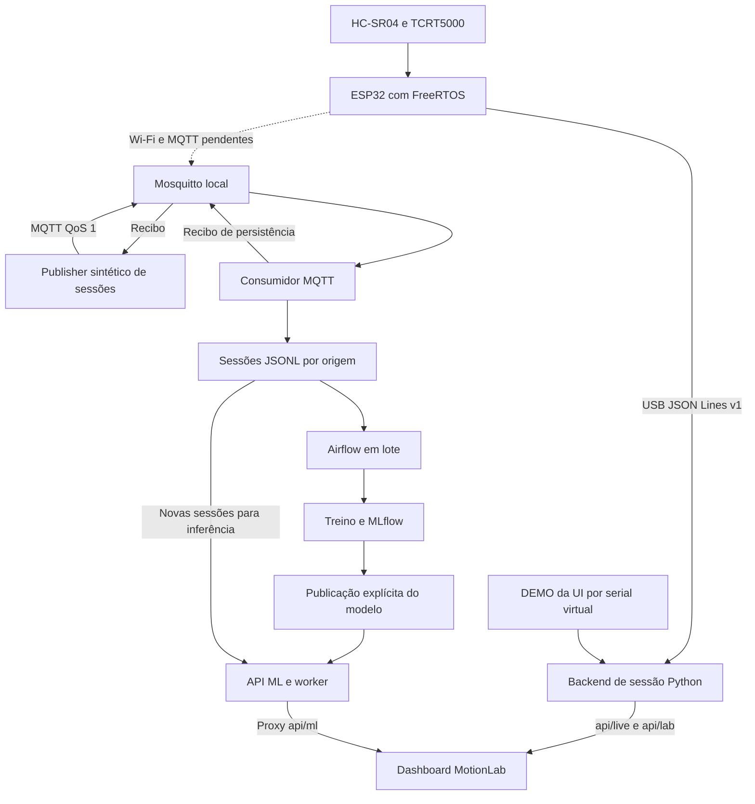

# Arquitetura atual e contratos MQTT

Figura para inserção manual: [PNG](figuras/figura-3-arquitetura.png) e [SVG](figuras/figura-3-arquitetura.svg). As conexões pendentes aparecem tracejadas e rotuladas. Este arquivo inventaria os fluxos; a descrição acadêmica deve ser escrita pelo grupo.

## Fluxos sustentados por evidências

| Caminho | Etapas | Evidência / nível |
|---|---|---|
| USB existente | HC-SR04/TCRT5000 → ESP32/FreeRTOS → USB serial JSON Lines v1 → `TerminalHostClient` / `MotionPetSession` → `MotionEngine` → `/api/live`, `/api/lab` → interface web | Implementado, build/testes; observação física anterior registrada pelo usuário; não reexecutado na placa agora |
| DEMO da interface | `SimulatedEsp32Node` / `SensorSimulator` → serial virtual em memória → mesma sessão/backend → interface web | HTTP atual: `connection.port=DEMO`, `origin=DEMO`. Este caminho **não passa pelo broker** |
| MQTT de software | Gerador sintético de `publish_demo` → Mosquitto → `consume` → sessões JSONL → Airflow → experimento/MLflow → publicação explícita → API/worker → proxy do dashboard | Integração de software da Fase C registrada; não foi reiniciada a stack nesta rodada |
| Novos dados após treino | Sessão JSONL persistida → `PredictionWorker` usa modelo publicado → `predictions.json` → `/v1/predictions` → `/api/ml/predictions` | Não exige retreinar a cada sessão; não passa novamente por Airflow para cada previsão |
| Retorno USB | Comandos de aquisição/diagnóstico e domínio legado → USB → ESP32 → ACK/erro | Contrato existente; não é comando MQTT nem demonstração de atuador físico |
| Retorno MQTT | Consumidor → recibo com hash → publisher de demonstração | Confirma persistência da aplicação, além da entrega MQTT |
| Futuro transporte físico | ESP32 → Wi-Fi da LAN → broker do notebook → infraestrutura existente | **Não implementado na ESP32; sem validação física. Suspenso nesta preparação** |



## Tópicos existentes

Contrato implementado em `ml/mqtt_ingestion.py`. O firmware vigente **não é publisher nem subscriber MQTT**.

| Tópico | Publisher | Subscriber | Formato / situação |
|---|---|---|---|
| `motionlab/v1/sessions/demo` | `python -m ml.mqtt_ingestion publish-demo`; verificador da Fase C | `consume`, cliente `motionlab-ingest-v1` | Envelope JSON de sessão completa; demonstrado em software |
| `motionlab/v1/sessions/synthetic` | Produtor compatível com o contrato, se usado | Mesmo consumidor | Assinatura implementada; origem `synthetic_simulator`; sem demonstrar uma publicação nova aqui |
| `motionlab/v1/sessions/real` | Futuro produtor/ponte de sessões reais | Consumidor apenas com `--allow-real` | Contrato preparado; não prova aquisição da ESP32 por rede; Compose padrão não habilita real |
| `motionlab/v1/receipts/<session_id>` | Consumidor, depois de persistir ou reconhecer duplicata | Publisher demo assina `motionlab/v1/receipts/+`; verificador também espera confirmação | JSON com estado, origem, identificador da sessão e SHA-256 do corpus |
| `motionlab/health` | `mosquitto_pub` do healthcheck do Compose | Nenhum consumidor de dados de aplicação | Mensagem `ok`; diagnóstico, não telemetria de sensor |

Sessões e recibos são publicados com **QoS 1**, sem retenção no publisher demo. O consumidor usa sessão MQTT persistente e ACK manual após tratar a mensagem. Reenvio de mesmo `session_id`/conteúdo é idempotente; conteúdo diferente com o mesmo ID é conflito. Não existe a alegação de “exatamente uma vez” no transporte. A persistência compara o digest e publica o JSONL atomicamente, inclusive sob corrida entre processos.

## Exemplo proveniente de dados existentes

[Envelope completo de 191 registros](evidencias/mqtt-sessao-demo.json), reconstruído do arquivo que a Fase C persistiu: `data/experiments/phase-c/delivery-stack/raw/demo/mqtt_demo_p01_42_6160d119.jsonl`. O arquivo de apoio preserva os valores e a origem; **não é uma nova captura de pacote MQTT nem dado de sensor real**. Seu digest foi conferido com o recibo histórico.

Primeiro registro efetivo dessa sessão, sem inventar números:

```json
{
  "participant_id": "demo_p01",
  "session_id": "mqtt_demo_p01_42_6160d119",
  "sample_idx": 0,
  "ts_ms": 73,
  "label": "NEUTRAL",
  "distance_cm": 76.44,
  "valid_ultrasonic": true,
  "ir_detected": false,
  "pot_norm": 0.5,
  "data_origin": "synthetic_simulator",
  "captured_at_iso": "2026-11-11T20:02:08.538575+00:00"
}
```

O envelope tem `schema_version=1`, `cohort="demo"` e `records=[...]`. **Um registro isolado não é um envelope válido de sessão**: o consumidor exige 10–10.000 registros, índices contíguos a partir de zero, timestamps crescentes, proveniência e identificadores seguros. Esse contrato é diferente do envelope serial `v/seq/type/ts_ms/data`. Não afirmar que basta encaminhar cada linha serial para o tópico de sessões sem adaptação.

Os [recibos extraídos dos logs originais](evidencias/mqtt-recibos-fase-c.txt) incluem `persisted` e `duplicate` para a sessão acima. Digest do corpus: `85a580624dff0bc805eb429c259f7ded4da687687f9f6c89e96267307afb9338`. A [verificação atual isolada](evidencias/mqtt-compatibilidade.json) confirmou aceitação e deduplicação com o consumidor de persistência, sem broker ou ESP32.

Não foram criados novos tópicos para a placa. Identificador de dispositivo, sequência por boot, relógio da placa, sessão de aquisição contínua e estratégia de perda/reconexão são decisões da futura implementação suspensa.

## Serviços, portas e armazenamento

| Serviço | Tecnologia / caminho | Endereço e evidência |
|---|---|---|
| Broker | Eclipse Mosquitto 2.0.22; `ops/mlops/mosquitto.conf` e `compose.yaml` | Host `127.0.0.1:1883`; listener 1883 dentro do container; sem listener nessa porta na conferência atual |
| Consumidor | Python + Paho MQTT 2.1.0; `ml/mqtt_ingestion.py` | Serviço Compose `ingest`, dados em pasta compartilhada |
| Persistência | JSONL por sessão/origem; JSON de metadados/publicação/previsões | `raw/{demo,synthetic,real}/`, `pipeline/` no DataDir da stack; não há PostgreSQL separado neste caminho |
| Airflow | Runtime 3.1.6; `ops/mlops/dags/motionlab_experiment.py` | `airflow dags test` com quatro tarefas reais no histórico; scheduler/console contínuo não comprovado por esse modo |
| MLflow | 3.18.0, servidor HTTP e SQLite | Porta 5000 na stack; execução histórica registrada; não reiniciada para estas evidências |
| API de inferência | HTTP Python, scikit-learn; `ml/inference_api.py`, `ml/prediction_worker.py` | `http://127.0.0.1:8768`, responde agora; modelo publicado identificado |
| Dashboard | HTTP Python; `terminal/web/`; HTML/CSS/JS | Porta padrão 8767; demonstração existente em `http://127.0.0.1:8790/` |
| Nuvem de execução | Nenhuma identificada no código/configuração ativa | GitHub armazena código; AWS é opção no enunciado, não serviço comprovadamente usado |

Na stack, `mqtt`, `api` e `mlflow` são nomes DNS internos dos containers, não endereços que a ESP32 possa usar pela LAN. `127.0.0.1` na ESP32 aponta para a própria ESP32. A configuração atual do Compose publica o broker só no loopback IPv4 do notebook. **Acesso de outro dispositivo na rede não está preparado nem validado**, incluindo roteamento WSL, isolamento da rede e firewall. Nenhuma regra de rede foi alterada.

## IPv6 e requisitos de Embarcados

Página 4 do enunciado: a linha “Funcionamento do Sistema” inclui protocolo IPv6; a Nota 1 menciona infraestrutura em IPv6 como extra com bônus. O projeto não tem evidência de tráfego MQTT fim a fim em IPv6. O suporte potencial de ESP32/Mosquitto/sistema operacional não é demonstração de uso. Registrar **pendente de esclarecimento com os professores**, sem marcar requisito atendido ou tratá-lo apenas como opcional.

O MQTT simulado atende à demonstração de software da disciplina de ML, mas não substitui a demonstração sem fio da ESP32 exigida em Embarcados.
