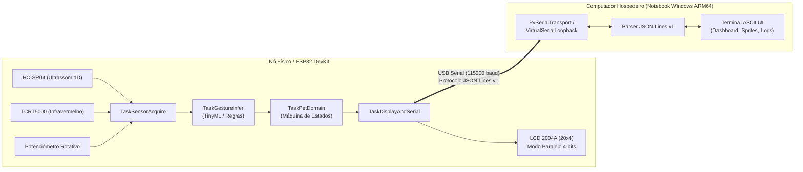

# Arquitetura do Sistema MotionPet

**Interface ativa no notebook (10/11/2026):** `terminal.web` serve HTML/CSS/JS em 127.0.0.1:8767. Uma única sessão Python mantém a USB e reaproveita `TerminalHostClient`, o estado do pet e o motor do Pet Launch. Os controles gráficos usam diretamente distância e transições do IR, sem potenciômetro. Os comandos de cuidado e recompensas voltam à ESP32; o progresso existente é preservado. O nome de apresentação é Piu-piu. Música é sintetizada no navegador após ação do usuário, e slides são uma apresentação interna. A configuração física escolhida exclui LCD. [Operação e limites](interface_notebook.md).

O restante deste documento conserva a arquitetura dos ciclos anteriores, incluindo o LCD opcional e o terminal ASCII.

O **MotionPet** é um sistema embarcado interativo que combina um pet virtual inteligente, controle por gestos no ar via sensores físicos e duas interfaces sincronizadas em tempo real: um display LCD de caracteres local (20x4) operado diretamente pelo microcontrolador e uma interface de terminal ASCII rica no computador hospedeiro.

---

## 1. Visão Geral do Sistema

O sistema é projetado para operar de forma híbrida: totalmente autônomo no hardware microcontrolado (com display LCD) ou conectado via USB Serial a um computador para telemetria, visualização gráfica estendida e controle via terminal.

### 1.1 Modos de Operação Planejados

1. **MotionPet (Modo Principal)**:
   - Simulação de vida artificial e animal de estimação virtual.
   - O pet possui atributos vitais: fome (`hunger`), felicidade (`happiness`), energia (`energy`), saúde (`health`), experiência (`xp`) e estágio evolutivo (`EGG` $\rightarrow$ `CHICK` $\rightarrow$ `CYBER_ROOSTER`).
   - A interação ocorre via gestos (`APPROACH` para carinho/alimentação, `RETREAT` para afastar, `HOLD` para repouso) ou comandos de console.
2. **Pet Launch (Mini-jogo)**:
   - Mini-jogo balístico com cálculo de trajetória em tempo real. O ângulo e a força de propulsão são calibrados por aproximação gestual ou ajuste fino no potenciômetro.
3. **Air Music**:
   - Instrumento musical gestual contínuo (estilo Theremin). A distância captada pelo sensor ultrassônico modula o tom/frequência, e o sensor óptico IR atua como disparador de nota (*trigger/gate*).
4. **Air Slides**:
   - Controle gestual sem contato para transição de slides e documentos, convertendo gestos de aproximação, afastamento e impulso em comandos direcionais.

### 1.2 Dualidade de Interfaces e Sincronização

O estado do pet é estritamente sincronizado entre duas interfaces:
- **Display Local LCD 2004A (20x4 caracteres)**: interface física embarcada de alta disponibilidade e latência mínima. Exibe status condensado, barra de vida/fome em caracteres customizados e ícones de humor.
- **Terminal ASCII Rico (Host)**: interface visual detalhada no computador, com renderização de sprites ASCII de grande escala (Ovo, Pintinho, Galo Cibernético), barras de progresso formatadas, histórico de eventos de sensores e console de comandos.

---

## 2. Decisões Arquiteturais (ADRs)

### ADR-01: Adoção do PlatformIO com C++ / FreeRTOS no ESP-WROOM-32

- **Contexto**: O projeto necessita de controle preciso de amostragem de sensores (ultrassom com temporização de ecos em microssegundos), atualização de display LCD e protocolo serial bidirecional sem bloqueios mútuos. A montagem atual usa backpack I²C PCF8574; veja o [guia final](bench_assembly_guide.md).
- **Decisão**: Utilizar o ecossistema **PlatformIO** com framework Arduino/FreeRTOS para o microcontrolador ESP-WROOM-32.
- **Justificativa**:
  1. O PlatformIO Core (v6.2.0) já se encontra instalado no ambiente do desenvolvedor, permitindo compilação e gerenciamento reproduzível de dependências sem depender de IDEs gráficas pesadas.
  2. O ESP32 possui suporte nativo ao FreeRTOS SMP pré-configurado, permitindo dividir tarefas em threads preemptivas dedicadas (`TaskSensorAcquire`, `TaskGestureInfer`, `TaskPetDomain`, `TaskDisplayAndSerial`).
  3. C++ embarcado estático evita gargalos de memória (*heap fragmentation*) ao processar strings e buffers de sensores em comparação com runtimes interpretados no chip.
- **Consequências**: Exige organização modular em headers `.h` e implementação `.cpp`, com isolamento claro de drivers de hardware e lógica de domínio.

### ADR-02: Fonte Única da Verdade (*Single Source of Truth*) para o Estado do Pet

- **Contexto**: Com duas interfaces simultâneas (LCD e Terminal), regras de negócio duplicadas poderiam divergir facilmente (por exemplo, fome crescendo em ritmos diferentes no chip e no Python).
- **Decisão**:
  - No modo físico conectado, o **ESP32 é a fonte autoritativa da verdade**. Ele executa o loop de evolução do pet e transmite periodicamente snapshots `pet_state` para o host.
  - No modo de desenvolvimento sem hardware (Ciclo 1), a classe `SimulatedEsp32Node` no Python executa exatamente a mesma máquina de estados determinística e envia os mesmos quadros `pet_state` através de um canal de loopback serial em memória (`VirtualSerialLoopback`).
- **Justificativa**: Garante que o Terminal seja um cliente desacoplado da lógica de negócio. A interface de terminal apenas reflete o estado recebido e despacha comandos (`pet_command`), tornando a transição de simulação para hardware físico 100% transparente.
- **Consequências**: O protocolo serial deve ser robusto e transportar o estado completo sem ambiguidade.

### ADR-03: Ambiente Python e Portabilidade no Windows ARM64

- **Contexto**: A máquina de desenvolvimento é um notebook Windows sobre arquitetura ARM64 executando Python 3.13 em ambiente virtual `.venv`. Pacotes binários compilados (rodas C/Cython não universais) podem causar falhas de compilação ou incompatibilidade.
- **Decisão**:
  - Manter o núcleo do Terminal e do Simulador (Ciclo 1) estritamente fundamentado na biblioteca padrão do Python (`json`, `dataclasses`, `time`, `threading`, `queue`, `re`, `typing`).
  - Isolar dependências externas como opcionais no `pyproject.toml` (`serial` com `pyserial` para I/O físico; `ml` com `numpy` e `scikit-learn` para pipelines futuros de treinamento em desktop).
- **Justificativa**: Elimina riscos de incompatibilidade na arquitetura ARM64 durante o ciclo fundamental de desenvolvimento e testes.
- **Consequências**: A interface de terminal do Ciclo 1 opera com ANSI escapes puros e threading nativo sem depender de bibliotecas pesadas de terceiros.

### ADR-04: Protocolo Serial JSON Lines v1 sobre USB Serial

- **Contexto**: A comunicação entre ESP32 e computador requer facilidade de depuração, integridade de transmissão e baixo acoplamento.
- **Decisão**: Adotar **JSON Lines v1** (`application/jsonlines`), onde cada mensagem é um objeto JSON delimitado por `\n`, contendo versão de esquema (`v: 1`), número de sequência incremental (`seq`), tipo (`type`), timestamp em milissegundos (`ts_ms`) e dados de carga útil (`data`).
- **Justificativa**:
  1. Permite inspeção humana direta em monitores seriais (PuTTY, Arduino Serial Monitor, script de terminal) sem necessidade de decodificadores binários proprietários.
  2. É simples de serializar e desserializar em Python com `json.loads`/`json.dumps` e em C++ com `ArduinoJson` (usando alocação estática `StaticJsonDocument` sem risco de fragmentação de heap).
  3. Resiliência: linhas com ruído ou quebras de frame são descartadas isoladamente na detecção do delimitador `\n`, sem travar a máquina de estados receptora.
- **Consequências**: Leve sobrecarga de largura de banda comparada a protocolos binários puros (Protobuf/CBOR), porém perfeitamente absorvida pela taxa de 115200 baud em taxas de atualização de 10 a 20 Hz.

---

## 3. Matriz de Status dos Componentes (Ciclos 1 a 6)

| Componente | Ciclo Alvo | Status Ciclo 1 | Descrição e Dependências |
| :--- | :---: | :---: | :--- |
| **Protocolo JSON Lines v1** | Ciclo 1 | **Implementado** | Especificação completa, schema com validação e parsers em Python e contratos em C++. |
| **Simulador de Nó ESP32** | Ciclo 1 | **Implementado** | `SimulatedEsp32Node` com loopback serial em memória, gerando dados de telemetria e estado idênticos ao hardware real. |
| **Terminal ASCII UI** | Ciclo 1 | **Implementado** | Interface rica com animação ASCII de pet, barras de status, painel de sensores e console interativo via stdlib. |
| **Contratos de Firmware C++** | Ciclo 1 | **Estruturado** | Interfaces de sensores, classificador de gestos, display e protocolo definidas em headers C++ no PlatformIO. |
| **Hardware e Cabeamento Físico** | Ciclo 2 | **Pendente de Validação** | Bancada física aguarda montagem com divisores de tensão e validação elétrica preventiva com multímetro. |
| **Pipeline de Coleta de Dados ML** | Ciclo 2 | **Contrato / Estruturado** | Especificação formal de captura de dados de ultrassom 1D e convenções de rotulação de gestos. |
| **Algoritmo de Reconhecimento de Gestos** | Ciclos 2/3 | **Baseline Simulado** | Heurística por regras de limiar no Ciclo 1; modelo TinyML (árvore/MLP compacta exportada para C++) nos Ciclos 2 e 3. |
| **Tasks FreeRTOS no ESP32** | Ciclo 3 | **Estruturado** | Arquitetura preemptiva multitarefa descrita e scaffold de headers pronto para compilação e flash. |
| **Mini-jogos (Pet Launch, Air Music)** | Ciclo 4 | **Planejado** | Módulos secundários baseados na captura de gestos e leitura de potenciômetro. |
| **Persistência EEPROM / NVS** | Ciclo 5 | **Planejado** | Gravação do estado e calibração na memória flash não volátil (NVS) do ESP32. |
| **Testes de Integração Ponta a Ponta** | Ciclo 6 | **Planejado** | Verificação de tolerância a desconexão de cabo USB e estabilidade contínua por 60 minutos. |
