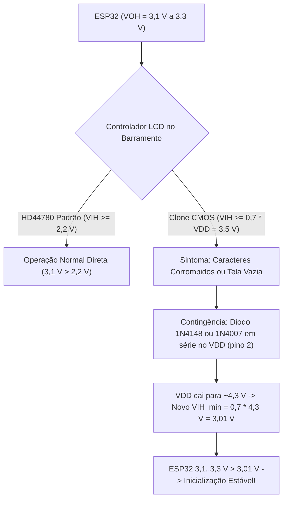
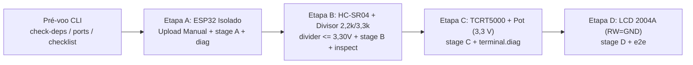

# Guia de Montagem e Comissionamento Assistido em Bancada — MotionPet (Ciclo 5)

> [!CAUTION]
> ### AVISO CRÍTICO DE ENGENHARIA: STATUS `PENDING_PHYSICAL_VALIDATION`
>
> - **Status de Pinagem:** `MOTIONPET_PINOUT_STATUS = "CANONICAL_GPIO34_PENDING_PHYSICAL_VALIDATION"`
> - **Versão do Firmware:** `MOTIONPET_FW_VERSION = "0.5.0-cycle5"` ([pinout_config.h](file:///c:/Users/joaoh/Downloads/ChickenLittle/firmware/main/pinout_config.h))
>
> As atribuições de pinos, diagramas esquemáticos e procedimentos detalhados neste documento estão **canonicamente reconciliados com o firmware**, mas aguardam execução e validação na bancada física real (**nenhuma medição física foi inventada**).
>
> **Regras Inegociáveis antes de Energizar:**
> 1. O microcontrolador **ESP32 opera internamente a 3,3 V e NÃO tolera 5 V em nenhum GPIO**. **`3,5 V` NÃO é aceito como tensão segura!** O teto máximo admissível medido no nó do divisor do `ECHO` é estritamente **`<= 3,30 V`** (faixa operacional recomendada de nível ALTO: **`2,50 V` a `3,20 V`**).
> 2. Existem múltiplos leiautes físicos comercializados como "ESP32 DevKit" (30, 36 ou 38 pinos, USB-C ou Micro-USB). **A serigrafia impressa na placa física real prevalece sempre sobre qualquer diagrama genérico.**
> 3. A gravação de firmware no ESP32 é **sempre manual pelo operador** (`pio run -d firmware -t upload --upload-port COMx`), e nenhuma etapa de comissionamento (`A -> B -> C -> D`) pode avançar caso ocorra qualquer reprovação elétrica no multímetro ou no assistente `terminal.bench`.

---

## 1. Topologia Elétrica Geral e Mapeamento Canônico de Pinos

### 1.1 Diagrama de Blocos de Alimentação e Terra Comum (*Common GND*)

O sistema opera com barramento duplo de alimentação provido pelo módulo ESP32 DevKit conectado via USB ao computador, exigindo **ponto de aterramento comum unificado** (*Common GND*):

```
       +-----------------------------------------------------------+
       |             HOST USB (5,00 V Nominal / <= 5,25 V)         |
       +-----------------------------------------------------------+
                                    |
                                    v [VBUS]
                     +-------------------------------+
                     |   ESP32 DevKit (ESP-WROOM-32) |
                     |                               |
                     |  [LDO 3,3 V]    [UART0 USB]   |
                     +-------+---------------+-------+
                             |               |
               3,3 V (3V3)   |               |   5,0 V (VIN / 5V)
            +----------------+               +------------------+
            |                                                   |
            +--> TCRT5000 VCC (Estrito 3,3 V!)                  +--> HC-SR04 VCC (ECHO c/ Divisor 2,2k/3,3k!)
            +--> Potenciômetro Terminal 1 (Estrito 3,3 V!)      +--> LCD 2004A VDD (Pino 2; RW=GND 0 Ω!)
            |                                                   +--> LCD Backlight A (Pino 15 via 100-220 Ω*)
            |                                                   |
   +--------+---------------------------------------------------+---------+
   |                  BARRAMENTO COMUM DE TERRA (GND)                     |
   +----------------------------------------------------------------------+
```

> [!IMPORTANT]
> **REGRA DE OURO DO TERRA COMUM (*Common GND*):**
> O terminal `GND` do ESP32, do HC-SR04, do TCRT5000, do potenciômetro, do LCD 2004A (`VSS`, `RW` pino 5 e `K` pino 16) e do resistor inferior `R2` (`3,3 kΩ`) do divisor de eco devem estar fisicamente interligados na mesma calha contínua de terra da protoboard (`0,0 Ω`).

---

### 1.2 Nota de Reconciliação Canônica de Pinagem (`GPIO34` vs `GPIO32`)

- No Ciclo 3 ([pinout_config.h](file:///c:/Users/joaoh/Downloads/ChickenLittle/firmware/main/pinout_config.h), linha 35), `PIN_HCSR04_ECHO` foi configurado em **`GPIO34`**. No resumo textual do Ciclo 4 ocorreu uma menção divergente a `GPIO32`.
- Após auditoria completa de todos os periféricos e restrições elétricas do `ESP-WROOM-32`, **`GPIO34` fica estabelecido no Ciclo 5 como o único pino canônico para `HC-SR04 ECHO`** (`MOTIONPET_PINOUT_STATUS = "CANONICAL_GPIO34_PENDING_PHYSICAL_VALIDATION"`):
  - É um pino **GPI *input-only*** de alta impedância (impossível configurá-lo acidentalmente como saída `3,3 V` contra o divisor resistivo).
  - Não possui função de *boot strapping*.
  - Não possui qualquer sobreposição com `TRIG` (`GPIO5`), `TCRT5000 DO` (`GPIO35`), `TCRT5000 AO` (`GPIO39`, opcional), `Potenciômetro` (`GPIO36` / `ADC1_CH0`), `LCD 2004A` (`RS=GPIO19`, `RW=GND fixo`, `E=GPIO18`, `D4=GPIO21`, `D5=GPIO22`, `D6=GPIO23`, `D7=GPIO27`) ou `UART0` (`GPIO1`/`GPIO3`).
- **Nenhuma migração de código foi necessária no firmware**, visto que o código C++ já utilizava `GPIO34`.

### 1.3 Tabela Consolidada Canônica de Conexões (Ciclo 5)

Em estrita conformidade com [hardware_safety.md](file:///c:/Users/joaoh/Downloads/ChickenLittle/docs/hardware_safety.md) e [pinout_config.h](file:///c:/Users/joaoh/Downloads/ChickenLittle/firmware/main/pinout_config.h):

| Módulo Periférico | Pino do Módulo | Pino no ESP32 | Direção / Função | Nível Elétrico | Restrição Crítica de Segurança |
| :--- | :--- | :--- | :---: | :---: | :--- |
| **HC-SR04** | `VCC` | `VIN` / `5V` | Alimentação | `5,0 V` | Exige `5 V` para emissão acústica de `40 kHz`. |
| **HC-SR04** | `GND` | `GND` | Referência | `0,0 V` | Barramento comum de terra. |
| **HC-SR04** | `TRIG` | `GPIO5` | Saída ESP32 | `3,3 V` | Direto (`3,3 V` atende ao limiar TTL `>= 2,0 V`). |
| **HC-SR04** | `ECHO` | **`GPIO34`** | Entrada GPI | **`<= 3,30 V`** (`3,00 V` nom.) | **OBRIGATÓRIO:** Divisor canônico **`R1 = 2,2 kΩ` / `R2 = 3,3 kΩ`**. Medir antes de ligar ao `GPIO34`! |
| **TCRT5000** | `VCC` | `3V3` | Alimentação | `3,3 V` | **NUNCA LIGAR EM `5 V`!** Estritamente `3,3 V`. |
| **TCRT5000** | `GND` | `GND` | Referência | `0,0 V` | Barramento comum de terra. |
| **TCRT5000** | `DO` | `GPIO35` | Entrada GPI | `0 V` / `3,3 V` | Entrada digital pura (`ir_active_low = true` padrão LM393). |
| **TCRT5000** | `AO` *(Opcional)* | `GPIO39` (`VN`) | Entrada `ADC1_CH3` | `0 V` a `3,3 V` | Leitura analógica opcional (desativada por padrão). |
| **Potenciômetro** | Terminal A | `3V3` | Alimentação | `3,3 V` | **NUNCA LIGAR EM `5 V`!** Estritamente `3,3 V`. |
| **Potenciômetro** | Terminal B | `GND` | Referência | `0,0 V` | Barramento comum de terra. |
| **Potenciômetro** | Cursor Central | `GPIO36` (`VP`) | Entrada `ADC1_CH0` | `0 V` a `3,3 V` | Normalizado `0.0..1.0` (`pot_norm`). |
| **LCD 2004A** | 1 (`VSS`) | `GND` | Referência | `0,0 V` | Barramento comum de terra. |
| **LCD 2004A** | 2 (`VDD`) | `VIN` / `5V` | Alimentação | `5,0 V` | Contingência clone CMOS: diodo `1N4148`/`1N4007` em série. |
| **LCD 2004A** | 3 (`V0`) | Resistor p/ `GND` | Contraste | `0,4 V` a `0,8 V` | Resistor fixo `1,0 kΩ` a `2,2 kΩ` para `GND` (após calibração). |
| **LCD 2004A** | 4 (`RS`) | `GPIO19` | Saída ESP32 | `3,3 V` | *Register Select* (`0` = Comando, `1` = Dado). |
| **LCD 2004A** | 5 (`RW`) | **`GND`** | Controle Fixo | **`0,0 V` (`0,0 Ω`)** | **ATERRAMENTO PERMANENTE AO `GND`:** Bloqueia retorno de `5 V`! |
| **LCD 2004A** | 6 (`E`) | `GPIO18` | Saída ESP32 | `3,3 V` | Pulso *Enable* de captura dos nibbles. |
| **LCD 2004A** | 7..10 (`D0..D3`) | `NC` (Aberto) | Dados Baixos | Flutuante | Deixar desconectados (modo paralelo 4 bits). |
| **LCD 2004A** | 11 (`D4`) | `GPIO21` | Saída ESP32 | `3,3 V` | Linha de dados bit 4. |
| **LCD 2004A** | 12 (`D5`) | `GPIO22` | Saída ESP32 | `3,3 V` | Linha de dados bit 5. |
| **LCD 2004A** | 13 (`D6`) | `GPIO23` | Saída ESP32 | `3,3 V` | Linha de dados bit 6. |
| **LCD 2004A** | 14 (`D7`) | `GPIO27` | Saída ESP32 | `3,3 V` | Linha de dados bit 7. |
| **LCD 2004A** | 15 (`A`) | `VIN` / `5V` | Backlight Ânodo | `5,0 V` | Em série com resistor `100–220 Ω` se PCB não tiver SMD `R8`/`R9`. |
| **LCD 2004A** | 16 (`K`) | `GND` | Backlight Cátodo | `0,0 V` | Barramento comum de terra. |
| **UART0 USB** | `TX0` / `RX0` | `GPIO1` / `GPIO3` | Serial USB | `3,3 V` interno | Exclusivo para JSON Lines v1 (`115200 baud`); sem fios externos. |

---

### 1.4 Detalhamento dos Circuitos de Condicionamento

#### 1.4.1 Divisor Resistivo Canônico do Sensor HC-SR04 (`ECHO -> GPIO34`)

O sensor HC-SR04 emite pulsos de `5,00 V` (até `5,25 V` em sobretensão USB) no pino `ECHO`. Como **`3,50 V` é terminantemente proibido** e o teto máximo admissível no GPIO do ESP32 é **`<= 3,30 V`**, o Ciclo 5 estabelece o divisor canônico **`R1 = 2,2 kΩ`** e **`R2 = 3,3 kΩ`**:

$$\text{Fator} = \frac{R_2}{R_1 + R_2} = \frac{3300\,\Omega}{2200\,\Omega + 3300\,\Omega} = 0,600$$

- Em $V_{ECHO} = 5,00\text{ V}$: **$V_{out} = 3,00\text{ V}$** (bem acima de $V_{IH\text{ min}} = 2,475\text{ V}$ e `0,30 V` abaixo do teto de `3,30 V`).
- Em sobretensão máxima USB ($V_{USB} = 5,25\text{ V}$): **$V_{out\text{ max}} = 3,15\text{ V}$** (`0,15 V` de margem abaixo de `3,30 V`!).

```
                    ECHO (5,00 V TTL do HC-SR04)
                              |
                              +---------------+
                                              |
                                             [ ]  R1 = 2,2 kΩ (Vermelho, Vermelho, Vermelho)
                                             [ ]
                                              |
                         Nó Intermediário ----+-----> GPIO34 do ESP32 (GPI Input-Only)
                         V_out = 3,00 V @ 5V  |       (MEDIR <= 3,30 V ANTES DE LIGAR!)
                         V_max = 3,15 V @5,25V|
                                             [ ]
                                             [ ]  R2 = 3,3 kΩ (Laranja, Laranja, Vermelho)
                                              |
                                             === GND COMUM
```

- **Alternativas Seguras Aprovadas (se `2,2 kΩ / 3,3 kΩ` não estiverem disponíveis na bancada)**:
  1. **`R1 = 4,7 kΩ` + `R2 = 6,8 kΩ`**: fator `0,591` $\rightarrow$ **`2,96 V`** @ `5,00 V` e **`3,10 V`** @ `5,25 V`.
  2. **Associação em série de resistores idênticos de `1 kΩ`**: **`R1 = 2×1 kΩ` (`2,0 kΩ`) + `R2 = 3×1 kΩ` (`3,0 kΩ`)**: fator `0,600` $\rightarrow$ **`3,00 V`** @ `5,00 V` e **`3,15 V`** @ `5,25 V`.
- **Descontinuação Explícita de `1 kΩ / 2 kΩ`**: O par antigo `R1 = 1 kΩ, R2 = 2 kΩ` (fator `0,667`) gera **`3,33 V` @ `5,00 V`** e **`3,50 V` @ `5,25 V`**, violando o teto de `3,30 V`, estando **proibido no Ciclo 5**.

#### 1.4.2 Sensor Óptico Reflexivo `TCRT5000`: Módulo LM393 vs Cápsula Discreta

- **Caso A — Módulo Breakout com PCB e LM393 (3 ou 4 pinos)**:
  - Conecte `VCC` **estritamente ao trilho `3,3 V` (`3V3`)** do ESP32 e `GND` ao terra comum.
  - Conecte `DO` diretamente ao `GPIO35` (e `AO` opcionalmente ao `GPIO39`).
  - Calibre o trimpot multivoltas/fenda até que o LED indicador de detecção acenda apenas quando o dedo se aproximar a `0,5..2,0 cm`.
- **Caso B — Cápsula Discreta de 4 Terminais (Sem PCB)**:
```
  +3,3 V (3V3) --------------+-----------------------+
                             |                       |
                            [ ] R_led = 180 Ω       [ ] R_pullup = 10 kΩ
                            [ ]                     [ ]
                             |                       |
                           ( A )                   ( C )
                         +-------+               +-------+
                         |  LED  |   Reflexão    | FOTO- |
                         |  IR   | ~ ~ ~ ~ ~ >   | TRANS |
                         +-------+               +-------+
                           ( K )                   ( E )
                             |                       +-----> GPIO35 do ESP32
                             |                       |
   GND Comum ----------------+-----------------------+
```

#### 1.4.3 Estratégia de Alocação para o Potenciômetro Único

1. **Calibração Inicial de Contraste do LCD (Opcional)**: Caso necessário testar o ponto ideal de `V0` de um módulo específico, ajuste e substitua imediatamente por um **resistor fixo de `1,0 kΩ` a `2,2 kΩ` entre `V0` (pino 3) e `GND`**.
2. **Alocação Definitiva de Operação (Entrada Analógica do Usuário)**: Conecte os terminais extremos do potenciômetro estritamente entre **`3,3 V` (`3V3`)** e **`GND`**, e o cursor central ao **`GPIO36` (`VP` / `ADC1_CH0`)** para controle analógico em tempo real nos modos *Pet Launch*, *Air Music* e *Tamagotchi*.

#### 1.4.4 Compatibilidade Lógica do LCD 2004A V1.1 e Contingência de Diodo



### 1.5 Restrições Rígidas de Hardware (`ESP-WROOM-32`)

1. **`GPIO6` a `GPIO11` (SPI Flash Interna)**: **TERMINANTEMENTE PROIBIDOS** (qualquer fio causa *Guru Meditation Error*).
2. **`GPIO12` (`MTDI` Strapping)**: **MANTER 100% LIVRE** (nível alto no boot muda `VDD_SDIO` para `1,8 V` e trava em `flash read err, 1000`).
3. **`GPIO34`, `GPIO35`, `GPIO36`, `GPIO39`**: GPIs *input-only* sem *pull-up*/*pull-down* internos.
4. **`GPIO1` (`TX0`) e `GPIO3` (`RX0`)**: exclusivos para a `UART0` (`115200 baud`, JSON Lines v1).
5. **Conversão Analógica Exclusiva no `ADC1`**: `GPIO36` (`ADC1_CH0`) e `GPIO39` (`ADC1_CH3`), evitando conflitos com o bloco `ADC2`.

---

## 2. Roteiro de Comissionamento Incremental Assistido (`Etapas A -> B -> C -> D`)

O Ciclo 5 introduz o assistente interativo **`terminal.bench`** para guiar e validar cada etapa da montagem física.

> [!WARNING]
> **REGRA DE BLOQUEIO DE SEGURANÇA:** Se qualquer medição com multímetro ou verificação de `terminal.bench` falhar, **PARE IMEDIATAMENTE, desconecte o cabo USB e corrija a falha física**. Nunca avance da Etapa `A` para `B`, `B` para `C` ou `C` para `D` com pendência elétrica!



### Pré-voo no Computador Host

Antes de iniciar a montagem, valide as dependências do ambiente virtual Python, liste as portas COM e exiba o checklist de segurança:

```powershell
.\.venv\Scripts\python.exe -m terminal.bench check-deps
.\.venv\Scripts\python.exe -m terminal.bench ports
.\.venv\Scripts\python.exe -m terminal.bench checklist
```

---

### Etapa A — ESP32 Isolado via USB (Sem Periféricos na Protoboard)

**Objetivo**: Validar alimentação `5V`/`3V3`, conversor USB-Serial, gravação manual do firmware `0.5.0-cycle5` e protocolo JSON Lines v1 a `115200 baud`.

1. **Inspeção Física**: Encaixe apenas o ESP32 DevKit transpassando o canal central da protoboard, **sem nenhum sensor, resistor ou jumper conectado**.
2. **Conexão e Identificação da Porta Serial (`COMx`)**:
   - Conecte o cabo USB e rode `.\.venv\Scripts\python.exe -m terminal.bench ports` para confirmar a porta atribuída (ex.: `COM3` — substitua `COMx` abaixo pela porta real).
   - Meça com o multímetro DC: `VIN/5V` entre `4,75 V` e `5,25 V`; `3V3` entre `3,25 V` e `3,35 V`.
3. **Compilação e Gravação Manual do Firmware (`0.5.0-cycle5`)**:
   ```powershell
   pio run -d firmware
   pio run -d firmware -t upload --upload-port COMx
   ```
   *(Se `pio` não estiver no `PATH` global do PowerShell, utilize `& "$HOME\.platformio\penv\Scripts\pio.exe" run -d firmware -t upload --upload-port COMx`).*
4. **Validação Assistida da Etapa A**:
   ```powershell
   .\.venv\Scripts\python.exe -m terminal.bench stage A --serial-port COMx
   .\.venv\Scripts\python.exe -m terminal.bench diag --serial-port COMx
   ```
   *(Confirma recepção de `sensor_frame` estável a ~70 ms com `valid_ultrasonic: false` por ausência intencional do sensor e resposta válida ao comando `DIAG`).*

---

### Etapa B — Montagem Prioritária P0: `HC-SR04` + Divisor `2,2 kΩ / 3,3 kΩ` (`ECHO -> GPIO34`)

**Objetivo**: Validar o condicionamento seguro `<= 3,30 V` do sinal `ECHO` e habilitar a medição real de distância ultrassônica no pino canônico `GPIO34`.

1. **Desenergização Obrigatória**: Desconecte o cabo USB do ESP32.
2. **Medição Ôhmica Fora do Circuito**:
   - Meça **`R1 = 2,2 kΩ`** (faixa aceitável `±5%`: `2,09 kΩ` a `2,31 kΩ`) e **`R2 = 3,3 kΩ`** (faixa aceitável `±5%`: `3,14 kΩ` a `3,47 kΩ`) — ou um dos pares alternativos aprovados na Seção 1.4.1.
3. **Montagem sem o `GPIO34` Conectado**:
   - Conecte `HC-SR04 GND` ao `GND` comum, `HC-SR04 VCC` ao `5V/VIN` e `HC-SR04 TRIG` ao `GPIO5`.
   - Ligue `R1` (`2,2 kΩ`) entre `HC-SR04 ECHO` e o nó intermediário; ligue `R2` (`3,3 kΩ`) entre o nó intermediário e `GND` comum.
   - **MANTENHA O JUMPER DO NÓ PARA O `GPIO34` DESCONECTADO!**
4. **Medição Elétrica do Nó e Registro com `terminal.bench divider`**:
   - Reconecte o cabo USB e meça a tensão de nível alto / pico no nó entre `R1` e `R2` (com osciloscópio ou ensaio DC equivalente em nível alto):
   - Valide os valores reais no assistente CLI (informando a tensão medida em `--measured-v`):
     ```powershell
     .\.venv\Scripts\python.exe -m terminal.bench divider --r1 2200 --r2 3300 --measured-v 3.00
     ```
   - **CRITÉRIO DE PARADA IMEDIATA:** O valor medido **DEVE estar entre `2,50 V` e `3,20 V` e NUNCA exceder `3,30 V`**. Se medir `> 3,30 V` (ex.: `3,33 V`, `3,50 V` ou `5,0 V`), **desconecte o USB imediatamente e refaça o divisor!**
5. **Conexão ao `GPIO34` e Inspeção Metrológica a `25 cm`**:
   - Desconecte o cabo USB, conecte o jumper do nó intermediário ao **`GPIO34`** e reconecte o cabo USB.
   - Posicione um alvo plano (ou a palma da mão) a `25 cm` do sensor e execute:
     ```powershell
     .\.venv\Scripts\python.exe -m terminal.bench stage B --serial-port COMx
     .\.venv\Scripts\python.exe -m terminal.bench inspect --serial-port COMx --duration 5 --reference-cm 25
     ```

---

### Etapa C — Sensor Reflexivo `TCRT5000` (`3,3 V`) e Potenciômetro (`3,3 V` / `ADC1_CH0`)

**Objetivo**: Integrar detecção óptica de proximidade imediata (`GPIO35`) e entrada contínua do usuário (`GPIO36`), ambos estritamente no barramento `3,3 V`.

1. **Desenergização Obrigatória**: Desconecte o cabo USB.
2. **Conexão do `TCRT5000`**:
   - `VCC` $\rightarrow$ **`3V3` (`3,3 V`)** (**NUNCA `5 V`!**); `GND` $\rightarrow$ `GND` comum; `DO` $\rightarrow$ **`GPIO35`**; `AO` *(opcional)* $\rightarrow$ `GPIO39`.
3. **Conexão do Potenciômetro**:
   - Terminal extremo 1 $\rightarrow$ **`3V3` (`3,3 V`)** (**NUNCA `5 V`!**); Terminal extremo 2 $\rightarrow$ `GND` comum; Cursor central $\rightarrow$ **`GPIO36`** (`VP` / `ADC1_CH0`).
4. **Validação Assistida da Etapa C e Painel em Tempo Real**:
   - Reconecte o cabo USB e execute:
     ```powershell
     .\.venv\Scripts\python.exe -m terminal.bench stage C --serial-port COMx
     .\.venv\Scripts\python.exe -m terminal.diag --serial-port COMx
     ```
   - Confirme no painel `terminal.diag` que `ir_detected` alterna limpa e imediatamente ao aproximar o dedo (`< 1,5 cm`) e que `pot_norm` percorre suavemente de `0.00` a `1.00`.

---

### Etapa D — Display `LCD 2004A V1.1` (Modo Paralelo 4 bits, `RW = GND`)

**Objetivo**: Integrar a interface visual embarcada `20x4` a `5 Hz` garantindo proteção absoluta contra retorno de `5 V`.

```
       +--------------------------------------------------------------+
       |                 DISPLAY LCD 2004A V1.1 (HD44780)             |
       |  [1] [2] [3] [4] [5] [6] [7..10] [11] [12] [13] [14] [15] [16]|
       |  VSS VDD V0  RS  RW  E    D0..D3   D4   D5   D6   D7  A    K |
       +---+---+---+---+---+---+----+----+---+----+----+----+---+----+
           |   |   |   |   |   |    |    |   |    |    |    |   |    |
           |   |   |   |   |   |   (NC)  |   |    |    |    |   |    +-- GND Comum
           |   |   |   |   |   |         |   |    |    |    |   |
           |   |   |   |   |   |         |   |    |    |    |   +------- 5V (via 100-220 Ω se s/ SMD R8/R9)
           |   |   |   |   |   |         |   |    |    |    +----------> GPIO27 (D7)
           |   |   |   |   |   |         |   |    |    +---------------> GPIO23 (D6)
           |   |   |   |   |   |         |   |    +--------------------> GPIO22 (D5)
           |   |   |   |   |   |         |   +-------------------------> GPIO21 (D4)
           |   |   |   |   |   +---------------------------------------> GPIO18 (E)
           |   |   |   |   +-------------------------------------------> GND Comum (RW = 0,0 Ω OBRIGATÓRIO!)
           |   |   |   +-----------------------------------------------> GPIO19 (RS)
           |   |   +--- Resistor fixo 1,0 kΩ..2,2 kΩ para GND
           |   +------- 5V (VIN do ESP32; ou via diodo 1N4148/1N4007 em clone CMOS)
           +----------- GND Comum
```

1. **Desenergização Obrigatória**: Desconecte o cabo USB.
2. **Verificação do Backlight (Pinos 15 e 16)**: Se o PCB do LCD não possuir resistor SMD `R8`/`R9` na trilha do pino 15 (`A`), insira resistor de `100 Ω` a `220 Ω` em série com `5 V`; conecte o pino 16 (`K`) ao `GND`.
3. **Aterramento Obrigatório do Pino 5 (`RW`)**:
   - Conecte o pino 5 (`RW`) **diretamente ao `GND` comum** e meça continuidade com o multímetro: **exatamente `0,0 Ω`**.
4. **Fiação de Alimentação, Contraste e Dados**:
   - `1 (VSS) -> GND`, `2 (VDD) -> 5V/VIN`, `3 (V0) -> resistor 1 kΩ..2,2 kΩ p/ GND`.
   - `4 (RS) -> GPIO19`, `6 (E) -> GPIO18`, `7..10 (D0..D3) -> abertos (NC)`.
   - `11 (D4) -> GPIO21`, `12 (D5) -> GPIO22`, `13 (D6) -> GPIO23`, `14 (D7) -> GPIO27`.
5. **Energização e Validação da Etapa D e E2E**:
   - Reconecte o cabo USB e valide a Etapa D e o teste ponta a ponta:
     ```powershell
     .\.venv\Scripts\python.exe -m terminal.bench stage D --serial-port COMx
     .\.venv\Scripts\python.exe -m terminal.bench e2e --serial-port COMx
     ```
   - *(Se o backlight acender mas os caracteres aparecerem corrompidos ou ausentes com `V0` entre `0,4..0,8 V`, aplique a contingência da Seção 1.4.4 inserindo um diodo `1N4148`/`1N4007` em série no pino `VDD`)*.

---

## 3. Checklist de Inspeção Pré-Energização com Multímetro

> [!WARNING]
> Execute os itens `01` a `09` com o **cabo USB desconectado**. Qualquer falha implica **PARADA IMEDIATA**.

| # | Ponto de Teste | Instrumento / Escala | Procedimento | Critério Estrito de Aprovação | Ação Imediata se Falhar |
| :-: | :--- | :--- | :--- | :--- | :--- |
| **01** | Curto `5V/VIN` vs `GND` | Resistência / Continuidade | Ponta preta no `GND`, vermelha no `5V/VIN`. | `> 1 kΩ` (sem bip de curto). | Isolar trilho `5 V` e revisar jumpers. |
| **02** | Curto `3V3` vs `GND` | Resistência / Continuidade | Ponta preta no `GND`, vermelha no `3V3`. | `> 500 Ω` (sem bip de curto). | Isolar trilho `3,3 V` e revisar jumpers. |
| **03** | Divisor `HC-SR04`: `R1` | Resistência (`20 kΩ`) | Entre pino `ECHO` e nó intermediário. | **`2,09 kΩ <= R1 <= 2,31 kΩ`** (nom. `2,2 kΩ`). | Substituir por `2,2 kΩ` (ou par aprovado Seção 1.4.1). |
| **04** | Divisor `HC-SR04`: `R2` | Resistência (`20 kΩ`) | Entre nó intermediário e `GND` comum. | **`3,14 kΩ <= R2 <= 3,47 kΩ`** (nom. `3,3 kΩ`). | Substituir por `3,3 kΩ` (ou par aprovado Seção 1.4.1). |
| **05** | LCD Pino 5 (`RW`) p/ `GND` | Continuidade (`0 Ω`) | Entre pino 5 do LCD e pino `GND` do ESP32. | **Exatamente `0,0 Ω`** (bip contínuo). | **NÃO LIGAR!** Aterrar pino 5 direto no `GND`. |
| **06** | Alimentação `TCRT5000` | Inspeção + Continuidade | Verificar destino do pino `VCC` do TCRT5000. | Conectado exclusivamente ao **`3V3` (`3,3 V`)**. | Se estiver em `5 V`, mover para `3V3` imediatamente. |
| **07** | Alimentação Potenciômetro | Inspeção + Continuidade | Verificar terminais extremos do potenciômetro. | Extremos em **`3V3`** e **`GND`** (cursor no `GPIO36`). | Se estiver em `5 V`, mover para `3V3` imediatamente. |
| **08** | Flash SPI (`GPIO6..11`) | Inspeção Visual | Conferir pinos `GPIO6` a `GPIO11`. | **100% desconectados**. | Remover qualquer fio acoplado. |
| **09** | Strapping `GPIO12` e `UART0` | Inspeção Visual | Conferir `GPIO12`, `GPIO1` e `GPIO3`. | **100% desconectados** na protoboard. | Remover jumpers para evitar `flash read err` / falha serial. |
| **10** | Trilhos DC Energizados | Tensão DC (`20 V`) *(Etapa A)* | Medir `VIN` vs `GND` e `3V3` vs `GND`. | `VIN`: `4,75..5,25 V`; `3V3`: `3,25..3,35 V`. | Trocar cabo/porta USB se fora de faixa. |
| **11** | Tensão do Nó `ECHO` | Tensão DC / Osciloscópio *(Etapa B, sem `GPIO34`)* | Medir nó entre `R1` e `R2` antes de ligar `GPIO34`. | **Pico `2,50..3,20 V`, ESTRITAMENTE `<= 3,30 V`!** | **PARADA IMEDIATA se `> 3,30 V`!** Refazer divisor. |

---

## 4. Referência Consolidada de Comandos CLI do Ciclo 5 (PowerShell)

Substitua `COMx` pela porta real identificada (ex.: `COM3`):

### 4.1 Assistente de Bancada (`terminal.bench`) e Gravação Manual de Firmware

```powershell
# Verificação de ambiente, listagem de portas seriais e checklist
.\.venv\Scripts\python.exe -m terminal.bench check-deps
.\.venv\Scripts\python.exe -m terminal.bench ports
.\.venv\Scripts\python.exe -m terminal.bench checklist

# Validação matemática e experimental do divisor resistivo 2,2 kΩ / 3,3 kΩ (<= 3,30 V)
.\.venv\Scripts\python.exe -m terminal.bench divider --r1 2200 --r2 3300 --measured-v 3.00

# Compilação e upload MANUAL do firmware (0.5.0-cycle5) via PlatformIO
pio run -d firmware
pio run -d firmware -t upload --upload-port COMx

# Execução sequencial das Etapas A, B, C e D (bloqueia avanço se houver falha!)
.\.venv\Scripts\python.exe -m terminal.bench stage A --serial-port COMx
.\.venv\Scripts\python.exe -m terminal.bench stage B --serial-port COMx
.\.venv\Scripts\python.exe -m terminal.bench stage C --serial-port COMx
.\.venv\Scripts\python.exe -m terminal.bench stage D --serial-port COMx

# Diagnóstico sob demanda, inspeção metrológica a 25 cm e validação ponta a ponta (E2E)
.\.venv\Scripts\python.exe -m terminal.bench diag --serial-port COMx
.\.venv\Scripts\python.exe -m terminal.bench inspect --serial-port COMx --duration 5 --reference-cm 25
.\.venv\Scripts\python.exe -m terminal.bench e2e --serial-port COMx
```

### 4.2 Painel de Diagnóstico em Tempo Real (`terminal.diag`)

```powershell
# Monitoramento em tempo real da placa física na porta COMx
.\.venv\Scripts\python.exe -m terminal.diag --serial-port COMx

# Modo de simulação local (apenas ensaio de interface sem hardware conectado)
.\.venv\Scripts\python.exe -m terminal.diag --simulate
```

### 4.3 Coleta Guiada Multi-Participante e Pipeline Real TinyML (`ml.collection` e `ml.real_pipeline`)

Consulte o protocolo científico completo em [real_data_collection_guide.md](file:///c:/Users/joaoh/Downloads/ChickenLittle/docs/real_data_collection_guide.md):

```powershell
# Exibir plano recomendado da campanha multi-participante (>= 5 participantes)
.\.venv\Scripts\python.exe -m ml.collection --plan-campaign

# Captura guiada de sessão real (gravada estritamente em data/raw/real)
.\.venv\Scripts\python.exe -m ml.collection `
  --serial-port COMx `
  --participant p01 `
  --schedule "NEUTRAL:20,APPROACH:15,NEUTRAL:15,RETREAT:15,NEUTRAL:15,HOLD:15,NEUTRAL:20" `
  --conditions "bancada_interna_vel_normal" `
  --guided `
  --output-dir data/raw/real

# Pipeline completo: validação real -> features -> treino -> relatório -> exportação C++ -> verificação de build
.\.venv\Scripts\python.exe -m ml.real_pipeline `
  --raw-dir data/raw/real `
  --models-dir data/models `
  --reports-dir data/reports `
  --export-header firmware/gestures/tinyml_model.h `
  --verify-firmware-build
```

*(Após exportar `firmware/gestures/tinyml_model.h`, regrave manualmente o firmware com `pio run -d firmware -t upload --upload-port COMx` e execute `terminal.bench e2e --serial-port COMx`).*

---

## 5. Matriz de Resolução de Problemas em Bancada (*Troubleshooting*)

| Sintoma Observado | Causa Mais Provável | Procedimento de Isolamento e Correção |
| :--- | :--- | :--- |
| **ESP32 em *boot loop* com `flash read err, 1000`** | Pino `GPIO12` (`MTDI`) puxado para nível alto no boot (`VDD_SDIO` em `1,8 V`). | Desconecte qualquer fio ligado ao `GPIO12`. Deve permanecer 100% livre. |
| **`distance_cm: null` e `valid_ultrasonic: false` constantes** | 1. HC-SR04 alimentado em `3,3 V` em vez de `5 V`.<br>2. Mau contato no divisor `2,2 kΩ / 3,3 kΩ` ou `GPIO34`.<br>3. `TRIG` (`GPIO5`) e `ECHO` trocados. | 1. Confirmar `5,0 V` no `VCC` do HC-SR04.<br>2. Conferir `R1 = 2,2 kΩ`, `R2 = 3,3 kΩ` e continuidade até `GPIO34`.<br>3. Verificar `TRIG -> GPIO5` e `ECHO -> R1 -> GPIO34`. |
| **`terminal.bench divider` reprova tensão `> 3,30 V`** | Divisor montado com resistores antigos (`1 kΩ / 2 kΩ`), `R1`/`R2` invertidos ou `R2` desconectado do `GND`. | **Não conectar ao `GPIO34`!** Desligar USB, instalar `R1 = 2,2 kΩ` (`ECHO->Nó`) e `R2 = 3,3 kΩ` (`Nó->GND`) e remedir. |
| **LCD exibe blocos pretos nas linhas 0 e 2 e linhas 1 e 3 vazias** | Controlador HD44780 energizado mas não inicializado em 4 bits, ou contraste `V0` saturado. | 1. Confirmar `V0` entre `0,4 V` e `0,8 V` (`1 kΩ..2,2 kΩ` p/ `GND`).<br>2. Conferir `RW` (`0,0 Ω` p/ `GND`), `RS` (`GPIO19`), `E` (`GPIO18`) e `D4..D7` (`21, 22, 23, 27`). |
| **Caracteres corrompidos ou ausentes no LCD 2004A** | Clone CMOS exigindo $V_{IH\text{ min}} = 0,7 \cdot V_{DD} = 3,5\text{ V}$. | Inserir diodo `1N4148` ou `1N4007` em série no pino 2 (`VDD`) do LCD (reduz `VDD` para `~4,3 V` e $V_{IH\text{ min}}$ para `3,01 V`). |
| **Backlight do LCD apagado** | Falta de conexão nos pinos 15 (`A`) / 16 (`K`) ou resistor em série alto demais (`> 1 kΩ`). | Aterrar pino 16 (`K`) no `GND` e alimentar pino 15 (`A`) em `5 V` via resistor de `100 Ω` a `220 Ω` (ou direto se já houver SMD `R8`/`R9`). |
| **`pot_norm` instável ou preso nos extremos** | Mau contato do cursor no `GPIO36` ou terminais soltos na protoboard. | Confirmar terminais extremos em `3V3` e `GND` e medir variação linear de `0,00 V` a `3,30 V` no `GPIO36`. |
| **`ir_detected` sempre `true` sem obstáculo** | Trimpot do LM393 muito sensível ou luz infravermelha ambiente intensa. | Ajustar o trimpot do módulo TCRT5000 (alimentado em `3,3 V`) até apagar o LED sensor sem alvo a `< 2 cm`. |
