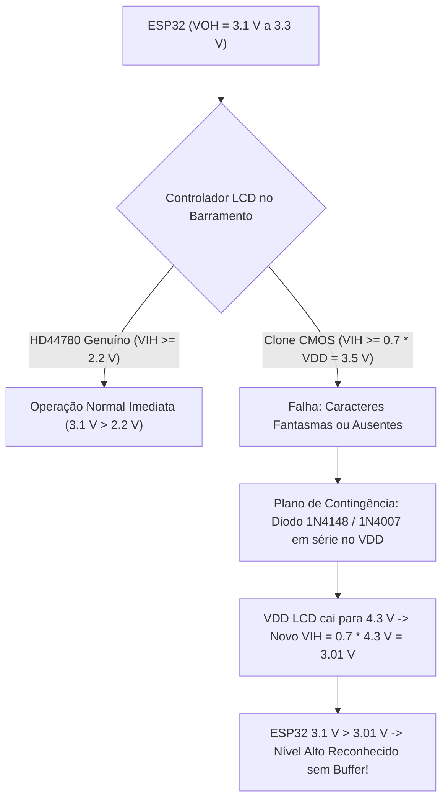
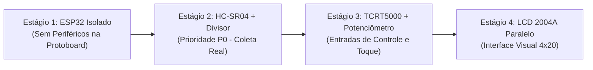

# Guia de Montagem e Comissionamento em Bancada — MotionPet (Ciclo 3)

> [!CAUTION]
> ### AVISO CRÍTICO DE ENGENHARIA: STATUS `PROPOSED_PENDING_BENCH_INSPECTION`
> 
> As atribuições de pinos, diagramas esquemáticos e procedimentos de interligação detalhados neste documento constituem uma **proposta de engenharia** (`MOTIONPET_PINOUT_STATUS = "PROPOSED_PENDING_BENCH_INSPECTION"`), em estrita conformidade com o cabeçalho [pinout_config.h](file:///c:/Users/joaoh/Downloads/ChickenLittle/firmware/main/pinout_config.h).
> 
> **NÃO energize a placa antes de executar a inspeção física e o checklist de multímetro:**
> 1. O microcontrolador **ESP32 opera internamente a 3,3 V e NÃO tolera 5 V em nenhum de seus pinos GPIO**. A injeção direta de 5 V (como o sinal puro de `ECHO` do HC-SR04 ou potencial retorno das linhas de dados do LCD) destruirá irreversivelmente o pino ou a pastilha de silício (*silicon latch-up*).
> 2. Existem múltiplos leiautes físicos de placas de desenvolvimento comercializadas sob a denominação "ESP32 DevKit" (modelos de 30 pinos estreitos, 36 pinos e 38 pinos largos, equipados com interface USB-C ou Micro-USB). **A serigrafia real impressa na placa física prevalece sobre qualquer diagrama genérico.**
> 3. Todos os passos descritos a seguir devem ser executados em bancada com bancada desenergizada, verificando cada barramento com multímetro digital calibrado.

---

## 1. Topologia Elétrica Geral e Mapeamento Consolidado de Pinos

### 1.1 Diagrama de Blocos de Alimentação e Barramentos

O sistema adota uma topologia de barramento duplo de alimentação provido pelo próprio módulo ESP32 conectado via porta USB-C ao host, com **ponto de aterramento comum obrigatório** (*Star Ground / Common GND*):

```
       +-----------------------------------------------------------+
       |               HOST USB-C (5.0 V Nominais)                 |
       +-----------------------------------------------------------+
                                     |
                                     v [VBUS]
                     +-------------------------------+
                     |   ESP32 DevKit (ESP-WROOM-32) |
                     |                               |
                     |  [LDO 3.3V]       [UART0 CH340]
                     +-------+---------------+-------+
                             |               |
               3.3 V (V33)   |               |   5.0 V (VIN/VBUS)
            +----------------+               +------------------+
            |                                                   |
            +--> TCRT5000 VCC (LM393)                           +--> HC-SR04 VCC
            +--> Potenciômetro Terminal 1                       +--> LCD 2004A VDD (Pino 2)
            |                                                   +--> LCD Backlight A (Pino 15)*
            |                                                   |
   +--------+---------------------------------------------------+---------+
   |                  BARRAMENTO COMUM DE TERRA (GND)                     |
   +----------------------------------------------------------------------+
```

> [!IMPORTANT]
> **REGRA DE OURO DO TERRA COMUM (*Common GND*):**
> O terminal de referência negativo (`GND`) do ESP32, do sensor ultrassônico HC-SR04, do módulo óptico TCRT5000, do potenciômetro, do display LCD 2004A e da malha inferior do divisor resistivo devem ser fisicamente interligados na mesma calha de terra da protoboard. A ausência de continuidade de terra provoca flutuação de potenciais, disparo errático de ecos ultrassônicos e risco iminente de condução reversa de 5 V pelo silício do microcontrolador.

---

### 1.2 Tabela Consolidada de Conexões Proposta

A matriz de pinagem abaixo consolida as diretrizes elétricas de [hardware_safety.md](file:///c:/Users/joaoh/Downloads/ChickenLittle/docs/hardware_safety.md) e as definições de compilação em [pinout_config.h](file:///c:/Users/joaoh/Downloads/ChickenLittle/firmware/main/pinout_config.h):

| Módulo Periférico | Pino do Módulo | Pino no ESP32 | Direção / Função | Nível Elétrico | Restrição Crítica de Segurança |
| :--- | :--- | :--- | :---: | :---: | :--- |
| **HC-SR04** | `VCC` | `VIN` / `5V` | Alimentação | $5,0\text{ V}$ | Exige $5\text{ V}$ para emissão dos transdutores ultrassônicos de $40\text{ kHz}$. |
| **HC-SR04** | `GND` | `GND` | Referência | $0\text{ V}$ | Barramento comum de terra. |
| **HC-SR04** | `TRIG` | `GPIO5` | Saída ESP32 | $3,3\text{ V}$ | Nível alto de $3,3\text{ V}$ atende ao limiar de disparo TTL ($V_{IH} \ge 2,0\text{ V}$). |
| **HC-SR04** | `ECHO` | `GPIO34` | Entrada ESP32 | $\le 3,3\text{ V}$ | **OBRIGATÓRIO:** Passar pelo divisor resistivo ($R_1 = 1\text{ k}\Omega$, $R_2 = 2\text{ k}\Omega$). **NUNCA direto!** |
| **TCRT5000** | `VCC` | `3V3` | Alimentação | $3,3\text{ V}$ | **NUNCA LIGAR EM 5 V!** Alimentar em $3,3\text{ V}$ garante saída `DO` segura a $3,3\text{ V}$. |
| **TCRT5000** | `GND` | `GND` | Referência | $0\text{ V}$ | Barramento comum de terra. |
| **TCRT5000** | `DO` | `GPIO35` | Entrada ESP32 | $0\text{ V} / 3,3\text{ V}$ | Pino de entrada pura (GPI). Nível baixo indica reflexão detectada (`ir_active_low = true`). |
| **TCRT5000** | `AO` *(Opcional)* | `GPIO39` / VN | Entrada ADC1 | $0\text{ a }3,3\text{ V}$ | Leitura analógica no canal `ADC1_CH3` (desativado por padrão no firmware). |
| **Potenciômetro** | Terminal A | `3V3` | Alimentação | $3,3\text{ V}$ | **NUNCA conectar a 5 V!** Conectar ao trilho de $3,3\text{ V}$. |
| **Potenciômetro** | Terminal B | `GND` | Referência | $0\text{ V}$ | Barramento comum de terra. |
| **Potenciômetro** | Cursor Central | `GPIO36` / VP | Entrada ADC1 | $0\text{ a }3,3\text{ V}$ | Canal `ADC1_CH0` (normalização $0,0\text{ a }1,0$). Ver estratégia de liberação abaixo. |
| **LCD 2004A** | 1 (`VSS`) | `GND` | Referência | $0\text{ V}$ | Barramento comum de terra. |
| **LCD 2004A** | 2 (`VDD`) | `VIN` / `5V` | Alimentação | $5,0\text{ V}$ | Alimentação principal do controlador HD44780. |
| **LCD 2004A** | 3 (`V0`) | Resistor fixo | Polarização | $0,4\text{ a }0,8\text{ V}$ | Resistor fixo de $1,0\text{ k}\Omega$ a $2,2\text{ k}\Omega$ conectado ao `GND` (ou pot de calibração). |
| **LCD 2004A** | 4 (`RS`) | `GPIO19` | Saída ESP32 | $3,3\text{ V}$ | Register Select: $0$ = Comando, $1$ = Dados. |
| **LCD 2004A** | 5 (`RW`) | `GND` | Controle | $0\text{ V}$ | **CONEXÃO PERMANENTE AO GND:** Força modo somente-escrita. Bloqueia linha de retorno 5 V! |
| **LCD 2004A** | 6 (`E`) | `GPIO18` | Saída ESP32 | $3,3\text{ V}$ | Enable clock de disparo dos nibbles de comando/dado. |
| **LCD 2004A** | 7..10 (`D0..D3`)| Não Conectado | Dados Baixos | Flutuante | Deixar pinos 7, 8, 9 e 10 desconectados (modo paralelo 4 bits). |
| **LCD 2004A** | 11 (`D4`)| `GPIO21` | Saída ESP32 | $3,3\text{ V}$ | Linha de barramento de dados bit 4. |
| **LCD 2004A** | 12 (`D5`)| `GPIO22` | Saída ESP32 | $3,3\text{ V}$ | Linha de barramento de dados bit 5. |
| **LCD 2004A** | 13 (`D6`)| `GPIO23` | Saída ESP32 | $3,3\text{ V}$ | Linha de barramento de dados bit 6. |
| **LCD 2004A** | 14 (`D7`)| `GPIO27` | Saída ESP32 | $3,3\text{ V}$ | Linha de barramento de dados bit 7. |
| **LCD 2004A** | 15 (`A`) | `VIN` / `5V` | Anode Backlight| $5,0\text{ V}$ | **Atenção:** Em série com resistor de $100\text{ a }220\,\Omega$ se placa não tiver resistor SMD. |
| **LCD 2004A** | 16 (`K`) | `GND` | Cathode Backlight| $0\text{ V}$ | Barramento comum de terra. |

---

### 1.3 Detalhamento de Circuitos de Condicionamento

#### 1.3.1 Divisor Resistivo do Sensor HC-SR04 (Proteção do Pino ECHO)

O sensor HC-SR04 gera no pino `ECHO` um pulso com amplitude de $V_{in} \approx 5,0\text{ V}$. Para compatibilizar com a entrada do ESP32 (`GPIO34`), calcula-se a razão resistiva:

$$V_{out} = V_{in} \cdot \frac{R_2}{R_1 + R_2} = 5,0\text{ V} \cdot \frac{2000\,\Omega}{1000\,\Omega + 2000\,\Omega} = 5,0\text{ V} \cdot 0,667 = 3,33\text{ V}$$

Em caso de sobretensão nominal de USB ($V_{USB} = 5,25\text{ V}$), o nó intermediário atinge $3,50\text{ V}$, o qual permanece seguro para a tolerância de transientes dos diodos de clamping do pino de entrada de alta impedância (`GPIO34`).

```
                    ECHO (5 V TTL do HC-SR04)
                              |
                              +---------------+
                                              |
                                             [ ]  R1 = 1,0 kΩ (Marrom, Preto, Vermelho)
                                             [ ]
                                              |
                         Nó Intermediário ----+-----> GPIO34 do ESP32 (Input-Only)
                         (Tensão <= 3,33 V)   |
                                             [ ]
                                             [ ]  R2 = 2,0 kΩ (ou 2x 1,0 kΩ em série)
                                              |
                                             === GND COMUM
```

#### 1.3.2 Sensor Óptico Reflexivo TCRT5000: Módulo LM393 vs Cápsula Discreta

Dependendo do componente presente no lote físico de bancada, siga a configuração correspondente:

##### Caso A: Módulo Breakout com Placa PCB e LM393 (Azul/Preto, 3 ou 4 pinos)
- Alimente o pino `VCC` do módulo **estritamente com 3,3 V** do ESP32.
- A saída `DO` (Digital Out) comuta entre $0\text{ V}$ e $3,3\text{ V}$ através de pull-up integrado à placa e ligado diretamente ao `GPIO35`.
- Gire o trimpot do comparador LM393 com uma chave de fenda para calibrar a distância de transição (típica: $0,5\text{ a }2,0\text{ cm}$).

##### Caso B: Cápsula Discreta de 4 Terminais (Sem Placa Comparadora)
Caso disponha da cápsula óptica isolada de 4 pinos, monte o circuito condicionador na protoboard:

```
  +3.3 V -------------------+-----------------------+
                            |                       |
                           [ ] R_led = 180 Ω       [ ] R_pullup = 10 kΩ
                           [ ]                     [ ]
                            |                       |
                          ( A )                   ( C )
                        +-------+               +-------+
                        |  LED  |   Reflexão    | FOTO- |
                        |  IR   | ~ ~ ~ ~ ~ >   | TRANS |
                        +-------+               +-------+
                          ( K )                   ( E )
                            |                       +-----> GPIO35 do ESP32
                            |                       |
   GND ---------------------+-----------------------+
```
- **LED Emissor IR (Corpo Transparente/Azulado)**: Ânodo em série com $R_{led} = 180\,\Omega$ para $+3,3\text{ V}$ (corrente $I_f \approx 11\text{ mA}$). Cátodo conectado ao `GND`.
- **Fototransistor Receptor (Corpo Escuro/Preto)**: Coletor ligado a resistor de *pull-up* de $10\text{ k}\Omega$ para $+3,3\text{ V}$ e derivado para o `GPIO35`. Emissor ligado ao `GND`.

#### 1.3.3 Estratégia Dupla para o Potenciômetro Único do Kit

O kit de hardware dispõe de **apenas 1 potenciômetro rotativo**. A engenharia do projeto define uma estratégia de alocação sequencial em dois passos:

1. **Fase 1 (Calibração Inicial de Bancada no Estágio 4)**:
   - Utilizar provisoriamente o potenciômetro conectado como divisor de tensão entre $5\text{ V}$ e `GND`, com o cursor móvel no pino `V0` do LCD.
   - Ajustar o eixo até obter o contraste ideal dos caracteres.
   - Medir a tensão do pino `V0` em relação ao `GND` com o multímetro (típico: entre $0,4\text{ V}$ e $0,8\text{ V}$).
   - Desconectar o potenciômetro e soldar/inserir um **resistor fixo equivalente** entre `V0` e `GND` (um resistor comum de **$1,0\text{ k}\Omega\text{ a }2,2\text{ k}\Omega$ para o GND** garante excelente legibilidade na quase totalidade dos módulos 2004A).
2. **Fase 2 (Alocação Definitiva para Entrada Analógica do Usuário - P0/P1)**:
   - Conectar definitivamente os extremos do potenciômetro entre **3,3 V** e **GND**.
   - Conectar o terminal central ao pino **`GPIO36 / VP (ADC1_CH0)`**.
   - O firmware efetuará a leitura de 12 bits ($0\text{ a }4095$) mapeada monotonicamente para $0,0\text{ a }1,0$ no campo `pot_norm` dos quadros `sensor_frame`.

#### 1.3.4 Análise Elétrica do LCD 2004A: Níveis Lógicos e Contingência

O LCD 2004A é alimentado em $5,0\text{ V}$ para correta resposta eletroquímica das moléculas de cristal líquido. As linhas de sinal do ESP32 entregam nível lógico de $3,3\text{ V}$ ($V_{OH} \approx 3,1\text{ V}$).



- **Controlador Hitachi HD44780 Genuíno**: A especificação fixa a tensão mínima de entrada de nível alto em $V_{IH\text{ min}} = 2,2\text{ V}$ sob $V_{DD} = 5,0\text{ V}$. Portanto, o sinal de $3,3\text{ V}$ do ESP32 atende com margem de segurança de $+0,9\text{ V}$ sem necessidade de conversores de nível.
- **Clones CMOS de Baixo Custo (KS0066U, SPLC780D)**: Algumas variantes CMOS exigem $V_{IH\text{ min}} = 0,7 \cdot V_{DD} = 3,5\text{ V}$. Sob alimentação estrita de $5,0\text{ V}$, $3,3\text{ V}$ pode cair na zona de transição indeterminada, gerando falhas de sincronismo ou tela vazia.
- **Plano de Contingência em Bancada**:
  - Inserir um diodo retificador de sinal ou potência (ex.: **1N4148**, **1N4007** ou diodo Schottky **1N5819**) em série na linha de alimentação `VDD` (pino 2 do LCD): Ânodo no barramento $+5\text{ V}$, Cátodo no pino 2 do LCD.
  - A queda de tensão direta do diodo ($\approx 0,7\text{ V}$) reduz o $V_{DD}$ efetivo do display para $\approx 4,3\text{ V}$.
  - O limiar de nível alto cai para:
    $$V_{IH\text{ min}} = 0,7 \times 4,3\text{ V} = 3,01\text{ V}$$
  - A saída de $3,1\text{ V}\text{--}3,3\text{ V}$ do ESP32 comutará o display com estabilidade total.

---

### 1.4 Restrições Rígidas de Hardware e GPIOs Proibidos (ESP-WROOM-32)

Ao interligar a bancada, **nunca utilize pinos fora do mapa proposto**:

1. **Barramento Flash SPI Interno (`GPIO6` a `GPIO11`) — TERMINANTEMENTE PROIBIDOS**:
   - `GPIO6` (CLK), `GPIO7` (SD0), `GPIO8` (SD1), `GPIO9` (SD2), `GPIO10` (SD3), `GPIO11` (CMD).
   - Estão interligados internamente ao chip de memória Flash SPI encapsulado no módulo WROOM-32. Qualquer conexão física externa causará parada imediata da CPU com falha de barramento (*Guru Meditation Error: Cache disabled*).
2. **Pinos de Boot e Strapping Críticos (`GPIO12`, `GPIO0`, `GPIO2`, `GPIO15`)**:
   - **`GPIO12` (MTDI — RISCO CRÍTICO DE BRICK TEMPORÁRIO)**: Se for forçado a nível alto ($3,3\text{ V}$) durante a energização (por um resistor de pull-up externo ou periferia conectada), a tensão do regulador interno que alimenta a memória flash é configurada para **1,8 V em vez de 3,3 V**. O chip entrará em *boot loop* perpétuo (*flash read err*). Mantenha o `GPIO12` totalmente desconectado.
   - **`GPIO0`**: Deve estar em nível alto durante o boot normal. Se puxado para terra, força o modo de gravação ROM bootloader.
   - **`GPIO2`**: Conectado ao LED de teste da placa em muitos DevKits; deve estar flutuante ou em nível baixo no boot.
3. **Pinos de Entrada Pura (Input-Only / GPIs)**:
   - `GPIO34`, `GPIO35`, `GPIO36` (VP), `GPIO39` (VN).
   - Não possuem transistores de pull-up/pull-down internos por hardware nem estágio de acionamento em saída (`OUTPUT`).
   - São dedicados exclusivamente para entradas analógicas (ADC1) e sensores digitais ativos como o HC-SR04 (via divisor) e TCRT5000 (via saída push-pull/pull-up do LM393).
4. **Isolamento de Barramento Serial UART0 (`GPIO1` e `GPIO3`)**:
   - `GPIO1` (TX0) e `GPIO3` (RX0) estão atrelados ao chip conversor USB-Serial da placa (CH340, CP2102 ou FTDI).
   - Devem ser mantidos dedicados com exclusividade para o protocolo serial estruturado **JSON Lines v1** a 115200 baud, sem nenhum jumper adicional na protoboard.
5. **Utilização Exclusiva do Bloco ADC1**:
   - O ESP32 possui dois ADCs. O periférico **ADC2** compartilha circuitos analógicos com o rádio Wi-Fi interno. Todas as entradas analógicas do projeto MotionPet estão ancoradas estritamente no bloco **ADC1** (`GPIO36` para potenciômetro e `GPIO39` para IR analógico opcional), prevenindo conflitos em ciclos de telemetria sem fio.

---

## 2. Roteiro de Montagem Incremental em 4 Estágios

Para garantir máxima segurança operacional e **desbloquear a coleta do dataset físico real (P0) antes de investir tempo na fiação paralela do LCD**, a montagem deve seguir rigorosamente a sequência de estágios abaixo:



---

### Estágio 1 — ESP32 Isolado via USB-C (Sem Periféricos na Protoboard)

**Objetivo**: Validar a integridade da placa ESP32, funcionamento do conversor USB-Serial, gravação do firmware do Ciclo 3 e resposta aos comandos do protocolo serial em 115200 baud.

1. **Acomodação Físico-Mecânica**:
   - Encaixe a placa ESP32 DevKit na protoboard de modo que ela transpasse a calha central divisória.
   - Certifique-se de que nenhum pino da fileira esquerda esteja em curto com a fileira direita.
   - **NÃO conecte nenhum sensor, fio de jumper ou resistor nesta fase.**
2. **Conexão USB e Verificação da Porta COM**:
   - Conecte o cabo USB-C do computador à placa ESP32.
   - Abra o terminal do PowerShell e identifique a porta COM atribuída pelo Windows:
     ```powershell
     [System.IO.Ports.SerialPort]::GetPortNames()
     ```
     *(Exemplo de retorno: `COM3` ou `COM4`)*.
3. **Compilação e Upload do Firmware**:
   - Compile o projeto com o PlatformIO:
     ```powershell
     & "$HOME\.platformio\penv\Scripts\pio.exe" run -d firmware
     ```
   - Efetue o upload manual indicando explicitamente a porta serial identificada:
     ```powershell
     & "$HOME\.platformio\penv\Scripts\pio.exe" run -d firmware -t upload --upload-port COM3
     ```
     *(Se a placa não entrar automaticamente em modo de gravação, pressione e segure o botão `BOOT` no DevKit quando aparecer `Connecting........_____` no terminal).*
4. **Verificação do Protocolo Serial**:
   - Abra um monitor serial puro a 115200 baud:
     ```powershell
     & "$HOME\.platformio\penv\Scripts\pio.exe" device monitor -d firmware -b 115200
     ```
   - O firmware inicializará emitindo linhas de telemetria `sensor_frame` a cada 70 ms:
     ```json
     {"v":1,"seq":1,"type":"sensor_frame","ts_ms":70,"data":{"distance_cm":null,"ir_detected":false,"pot_norm":0.0,"valid_ultrasonic":false}}
     ```
     *(Como os sensores ainda não estão instalados, `distance_cm` será `null` e `valid_ultrasonic` será `false`, o que confirma o correto tratamento de timeout sem travamento da CPU).*
   - Teste o envio de comandos em texto claro (pressione Enter após cada um):
     - Envie `DIAG` -> o ESP32 deve responder com envelope ACK JSON Lines v1:
       `{"v":1,"seq":...,"type":"ack","ts_ms":...,"data":{"ack_seq":0,"status":"diag:acq=on,per_ms=70,..."}}`
     - Envie `STOP` -> o fluxo de quadros `sensor_frame` cessa e recebe `status: "collection_stopped"`.
     - Envie `START` -> o fluxo de quadros `sensor_frame` recomeça e recebe `status: "collection_started"`.
   - Feche o monitor serial com `Ctrl + C`.

---

### Estágio 2 — Montagem Prioritária P0: HC-SR04 + Divisor Resistivo

> [!IMPORTANT]
> **ESTÁGIO CRÍTICO P0:** Este estágio estabelece o hardware necessário para a coleta do dataset real de gestos para o modelo TinyML. O display LCD não é necessário para esta fase e não deve atrasar a coleta!

1. **Desenergização**: Desconecte o cabo USB-C do computador.
2. **Inspeção e Medição Ôhmica Prévia dos Resistores**:
   - Com o multímetro na escala de resistência ($20\text{ k}\Omega$ ou autorange), meça os resistores antes da inserção:
     - $R_1$: confirme leitura de $0,98\text{ k}\Omega$ a $1,02\text{ k}\Omega$ (nominal $1,0\text{ k}\Omega$).
     - $R_2$: confirme leitura de $1,96\text{ k}\Omega$ a $2,04\text{ k}\Omega$ (nominal $2,0\text{ k}\Omega$).
3. **Montagem do Circuito na Protoboard**:
   - Encaixe o sensor HC-SR04 na extremidade da protoboard.
   - Conecte o pino `GND` do HC-SR04 à calha de terra comum (`GND` do ESP32).
   - Conecte o pino `VCC` do HC-SR04 ao pino `VIN` / `5V` do ESP32.
   - Conecte o pino `TRIG` do HC-SR04 diretamente ao `GPIO5` do ESP32.
   - Monte o divisor resistivo na protoboard:
     - Terminal 1 de $R_1$ ligado ao pino `ECHO` do HC-SR04.
     - Terminal 2 de $R_1$ ligado ao nó intermediário.
     - Terminal 1 de $R_2$ ligado ao nó intermediário.
     - Terminal 2 de $R_2$ ligado à calha de terra comum (`GND`).
   - **NÃO CONECTE O JUMPER DO NÓ AO GPIO34 AINDA!**
4. **Validação de Tensão de Pico com Multímetro (Teste Pré-GPIO34)**:
   - Conecte o cabo USB-C para energizar a bancada.
   - O firmware começará a enviar pulsos de trigger a cada 70 ms no `GPIO5`.
   - Posicione a mão a cerca de 20 cm dos transdutores ultrassônicos.
   - Com a ponta de prova preta do multímetro no `GND` e a ponta vermelha no nó intermediário entre $R_1$ e $R_2$ (escala de tensão contínua DC $20\text{ V}$):
     - Meça a tensão presente no nó. Devido ao ciclo de trabalho do trem de pulsos, o valor médio no multímetro DC ficará entre $0,2\text{ V}$ e $1,5\text{ V}$.
     - Se dispuser de osciloscópio de bancada, confirme amplitude de pico em **$3,3\text{ V}$**.
     - **Critério inegociável de aprovação:** A tensão contínua máxima medida sob qualquer condição **NUNCA pode ultrapassar 3,50 V**. Se a tensão ultrapassar 3,6 V, o divisor está invertido ou montado incorretamente. Corrija antes de prosseguir!
5. **Conexão Final e Validação de Aquisição**:
   - Desconecte o cabo USB.
   - Insira o jumper conectando o nó intermediário do divisor ao pino **`GPIO34`** do ESP32.
   - Reconecte o cabo USB.
   - Abra o monitor serial (`pio device monitor`) e confirme que o campo `distance_cm` reflete a distância real da sua mão e que `valid_ultrasonic: true`:
     ```json
     {"v":1,"seq":120,"type":"sensor_frame","ts_ms":8400,"data":{"distance_cm":18.2,"ir_detected":false,"pot_norm":0.0,"valid_ultrasonic":true}}
     ```
   - Feche o monitor serial.
6. **Desbloqueio Imediato da Coleta do Dataset Real**:
   - O hardware mínimo P0 está pronto para a gravação dos gestos com o pipeline de Machine Learning:
     ```powershell
     .\.venv\Scripts\python.exe -m ml.collection --serial-port COM3 --participant p01 --session-id session_real_p01_s01 --schedule "NEUTRAL:25,APPROACH:18,NEUTRAL:20,HOLD:22,NEUTRAL:20,RETREAT:18,NEUTRAL:25" --output-dir data/raw
     ```

---

### Estágio 3 — Adição do Sensor Reflexivo TCRT5000 (3,3 V) e Potenciômetro (ADC1)

**Objetivo**: Integrar a detecção óptica de toque por proximidade imediata e o controle analógico de usuário via `ADC1`.

1. **Desenergização**: Desconecte o cabo USB-C.
2. **Conexão do Sensor Infravermelho TCRT5000**:
   - **VCC**: Conecte obrigatoriamente à calha de **3,3 V** (pino `3V3` do ESP32).
   - **GND**: Conecte à calha de terra comum (`GND`).
   - **DO**: Conecte ao pino **`GPIO35`** do ESP32.
   - *(AO opcional: conecte ao `GPIO39` caso deseje testar leitura analógica contínua no futuro).*
3. **Conexão do Potenciômetro (Modo Usuário ADC1)**:
   - Terminal 1 (extremo): Conecte ao trilho de **3,3 V**.
   - Terminal 2 (extremo oposto): Conecte ao barramento comum de **GND**.
   - Terminal Central (cursor): Conecte ao pino **`GPIO36`** (`VP` / `ADC1_CH0`).
4. **Verificação Funcional em Monitor Serial**:
   - Reconecte o cabo USB e abra o monitor serial (`pio device monitor`).
   - **Teste do TCRT5000**:
     - Sem obstáculo próximo: `ir_detected` deve reportar `false`.
     - Aproxime a ponta do dedo a menos de 1,5 cm do sensor óptico: o LED indicador no módulo deve acender e o JSONL deve reportar imediatamente `ir_detected: true`.
     - Se o comportamento estiver invertido, ajuste o trimpot de sensibilidade com uma chave de fenda.
   - **Teste do Potenciômetro**:
     - Gire o potenciômetro totalmente no sentido anti-horário: `pot_norm` deve indicar valor próximo a `0.0`.
     - Gire o potenciômetro totalmente no sentido horário: `pot_norm` deve atingir `1.0`.
     - Posicione no centro: `pot_norm` deve estabilizar em aproximadamente `0.50` ($\pm 0.05$).

---

### Estágio 4 — Adição do Display LCD 2004A V1.1 (Modo Paralelo 4 bits)

**Objetivo**: Integrar a visualização alfanumérica de 4 linhas por 20 colunas com atualização periódica a 5 Hz.

```
       +--------------------------------------------------------------+
       |                   DISPLAY LCD 2004A (HD44780)                |
       |  [1] [2] [3] [4] [5] [6] [7..10] [11] [12] [13] [14] [15] [16]|
       |  VSS VDD V0  RS  RW  E    D0..D3   D4   D5   D6   D7  A    K |
       +---+---+---+---+---+---+----+----+---+----+----+----+---+----+
           |   |   |   |   |   |    |    |   |    |    |    |   |    |
           |   |   |   |   |   |   (NC)  |   |    |    |    |   |    +-- GND
           |   |   |   |   |   |         |   |    |    |    |   |
           |   |   |   |   |   +---------+---+----+----+----+---|---- 5V (via R=100-220Ω)*
           |   |   |   |   |             |   |    |    |    |   |
           |   |   |   |   |             |   |    |    |    +---|---> GPIO27
           |   |   |   |   |             |   |    |    +--------|---> GPIO23
           |   |   |   |   |             |   |    +-------------|---> GPIO22
           |   |   |   |   |             |   +------------------|---> GPIO21
           |   |   |   |   |             +----------------------|---> GPIO18 (E)
           |   |   |   |   +------------------------------------|---> GND (RW = OBRIGATÓRIO!)
           |   |   |   +----------------------------------------|---> GPIO19 (RS)
           |   |   |
           |   |   +--- Resistor fixo 1k..2.2k p/ GND (ou cursor do trimpot de contraste)
           |   +------- 5V (VIN do ESP32)
           +----------- GND Comum
```

1. **Desenergização**: Desconecte o cabo USB-C.
2. **Inspeção Prévia do Backlight do LCD (Pinos 15 e 16)**:
   - Inspecione a parte posterior da placa do LCD 2004A:
     - Localize a trilha que liga o pino 15 (`A`). Se houver um resistor SMD (marcado como `R8`, geralmente com estampa `101` para $100\,\Omega$), o pino 15 pode ser alimentado diretamente em $5\text{ V}$.
     - Se o espaço `R8` estiver curto-circuitado por um jumper ou vazio, **insira obrigatoriamente um resistor externo de $100\,\Omega\text{ a }220\,\Omega$ em série entre os $5\text{ V}$ e o pino 15**. O pino 16 (`K`) conecta-se diretamente ao `GND`.
3. **Conexão Obrigatória de Segurança do Pino RW (Pino 5)**:
   > [!CAUTION]
   > Conecte o pino 5 (`RW`) **DIRETAMENTE à calha de terra comum (`GND`)**.
   > Use o multímetro no modo de continuidade: confirme que a resistência entre o pino 5 do LCD e o pino GND do ESP32 é de **$0,0\,\Omega$**.
   > Essa conexão é a única garantia de que o LCD nunca colocará $5\text{ V}$ no barramento de dados (`D4`..`D7`).
4. **Conexões do Barramento de Controle e Dados**:
   - Pino 1 (`VSS`) $\rightarrow$ Barramento `GND`.
   - Pino 2 (`VDD`) $\rightarrow$ Barramento `5V` (`VIN`).
   - Pino 4 (`RS`) $\rightarrow$ `GPIO19`.
   - Pino 6 (`E`) $\rightarrow$ `GPIO18`.
   - Pinos 7, 8, 9 e 10 (`D0..D3`) $\rightarrow$ Deixar desconectados (*No Connection*).
   - Pino 11 (`D4`) $\rightarrow$ `GPIO21`.
   - Pino 12 (`D5`) $\rightarrow$ `GPIO22`.
   - Pino 13 (`D6`) $\rightarrow$ `GPIO23`.
   - Pino 14 (`D7`) $\rightarrow$ `GPIO27`.
5. **Ajuste de Contraste do Pino 3 (`V0`)**:
   - Conecte um resistor fixo de $1,0\text{ k}\Omega$ a $2,2\text{ k}\Omega$ entre o pino 3 (`V0`) e o `GND`.
   - *(Alternativa de calibração: conecte provisoriamente o potenciômetro entre $5\text{ V}$ e `GND`, com o cursor móvel em `V0`, ajuste até visualizar claramente os blocos/letras e substitua por resistor correspondente).*
6. **Energização e Teste Visual**:
   - Conecte o cabo USB-C.
   - O display deve acender o backlight azul/verde.
   - As 4 linhas devem exibir a tela de diagnóstico ou estado do pet:
     - Linha 0: Identificação e humor do Pet (`MotionPet v0.3`).
     - Linha 1: Status de sensores e distância em cm.
     - Linha 2: Barra de status gráfica (corações e alimentos nos glifos CGRAM).
     - Linha 3: Modo de operação (`MotionPet`).
   - Caso observe caracteres aleatórios ou ausência de inicialização, consulte a seção de *Contingência de Níveis Lógicos* (diodo em série no `VDD`).

---

## 3. Checklist de Inspeção e Validação Pré-Energização com Multímetro

> [!WARNING]
> Execute cada item do checklist abaixo com o **cabo USB completamente desconectado**. Não energize o circuito se qualquer medição reprovar nos critérios estipulados!

| # | Ponto de Teste | Instrumento / Escala | Procedimento de Teste | Critério de Aprovação | Ação se Falhar |
| :-: | :--- | :--- | :--- | :--- | :--- |
| **01** | Curto nos Trilhos $5\text{ V}$ e GND | Multímetro: Resistência ($200\,\Omega$) / Continuidade | Ponta preta no `GND`, ponta vermelha no trilho `5V/VIN`. | Resistência $> 1\text{ k}\Omega$ (sem bip de curto). | Isolar componentes até achar jumper errado ou capacitor em curto. |
| **02** | Curto nos Trilhos $3,3\text{ V}$ e GND | Multímetro: Resistência ($200\,\Omega$) / Continuidade | Ponta preta no `GND`, ponta vermelha no trilho `3V3`. | Resistência $> 500\,\Omega$ (sem bip de curto). | Remover jumpers para encontrar curto entre trilhos. |
| **03** | Divisor HC-SR04: $R_1$ | Multímetro: Resistência ($20\text{ k}\Omega$) | Entre terminal `ECHO` do HC-SR04 e nó do divisor. | $0,98\text{ k}\Omega \le R \le 1,02\text{ k}\Omega$. | Substituir resistor $R_1$ por valor nominal correto ($1\text{ k}\Omega$). |
| **04** | Divisor HC-SR04: $R_2$ | Multímetro: Resistência ($20\text{ k}\Omega$) | Entre nó do divisor e barramento comum `GND`. | $1,96\text{ k}\Omega \le R \le 2,04\text{ k}\Omega$. | Substituir resistor $R_2$ por valor nominal correto ($2\text{ k}\Omega$). |
| **05** | LCD Pino 5 (`RW`) p/ GND | Multímetro: Continuidade ($0\,\Omega$) | Entre pino 5 do conector do LCD e pino `GND` do ESP32. | **Exatamente $0,0\,\Omega$** (com bip sonoro firme). | **NÃO LIGAR!** Conectar o pino 5 direto ao GND da protoboard. |
| **06** | Alimentação do TCRT5000 | Inspeção Visual e Continuidade | Seguir o jumper de `VCC` do TCRT5000 até a placa. | Jumper conectado estritamente no barramento **3,3 V**. | Se estiver no 5 V, **mudar para 3,3 V imediatamente**. |
| **07** | Alimentação do Potenciômetro | Inspeção Visual e Continuidade | Seguir os fios dos terminais extremos do potenciômetro. | Ligados em **3,3 V** e **GND** (cursor no `GPIO36`). | Se extremo estiver no 5 V, **mudar para 3,3 V**. |
| **08** | Pinos Proibidos da Flash SPI | Inspeção Visual | Verificar pinos físicos `GPIO6`, `7`, `8`, `9`, `10`, `11`. | **100% livres**, sem nenhum jumper acoplado. | Remover jumpers indevidos desses pinos. |
| **09** | Pino de Strapping `GPIO12` | Inspeção Visual | Verificar pino físico correspondente ao `GPIO12`. | **100% livre**, sem pull-up externo conectado. | Deixar pino flutuante para evitar boot a 1,8 V. |
| **10** | Tensão de Alimentação USB | Multímetro: Tensão DC ($20\text{ V}$) *(Energizado sem sensores)* | Plugar USB. Medir entre `VIN` e `GND`, depois `3V3` e `GND`. | `VIN`: $4,75\text{ V a }5,25\text{ V}$<br>`3V3`: $3,25\text{ V a }3,35\text{ V}$. | Trocar cabo USB ou porta do PC se fora da faixa tolerável. |
| **11** | Tensão do Nó de Eco | Multímetro: Tensão DC ($20\text{ V}$) *(Sensor plugado, sem GPIO34)* | Medir tensão do nó intermediário do divisor com trigger ativo. | Tensão contínua média $< 2,0\text{ V}$ (pico $\le 3,5\text{ V}$). | Se indicar $\approx 5\text{ V}$, $R_2$ está desconectado do GND. Corrigir! |

---

## 4. Comandos Exatos de Operação e Validação de Bancada (PowerShell)

Todos os comandos abaixo foram validados no ambiente Windows com o Python virtual (`.\.venv`) e o compilador PlatformIO Core.

### 4.1 Identificação da Porta Serial USB
Execute no PowerShell para listar as portas disponíveis no computador:

```powershell
[System.IO.Ports.SerialPort]::GetPortNames()
```

*(Caso deseje informações detalhadas do dispositivo USB no Windows)*:
```powershell
Get-CimInstance Win32_SerialPort | Select-Object DeviceID, Description, PNPDeviceID
```

---

### 4.2 Compilação e Gravação Manual do Firmware

Compile a imagem limpa para o ambiente `esp32dev`:
```powershell
& "$HOME\.platformio\penv\Scripts\pio.exe" run -d firmware
```

Efetue o upload manual indicando a porta serial correspondente (substitua `COM3` pela sua porta real):
```powershell
& "$HOME\.platformio\penv\Scripts\pio.exe" run -d firmware -t upload --upload-port COM3
```

---

### 4.3 Monitor Serial Puro em 115200 Baud

Abra o monitor de texto puro para inspecionar os quadros e testar comandos de bancada:
```powershell
& "$HOME\.platformio\penv\Scripts\pio.exe" device monitor -d firmware -b 115200
```

#### Comandos de Linha Disponíveis para Envio Interativo:
- `DIAG` : Retorna status detalhado de tempo de aquisição, amostras e heap livre.
- `STOP` : Suspende a aquisição e transmissão contínua de quadros de telemetria.
- `START` : Retoma a aquisição periódica no intervalo configurado.
- `PERIOD 70` : Configura o período de amostragem em milissegundos (faixa permitida: $50\text{ ms a }500\text{ ms}$).
- `IR ON` / `IR OFF` : Habilita ou desabilita a leitura do sensor reflexivo TCRT5000.

*(Para fechar o monitor serial do PlatformIO, pressione `Ctrl + C`)*.

---

### 4.4 Captura de Sessão Real de Gestos (Pipeline ML — Prioridade P0)

Para iniciar uma sessão contínua guiada de coleta de dados para o participante `p01` (sessão 1) com o cronograma balanceado de classes de gestos:

```powershell
.\.venv\Scripts\python.exe -m ml.collection `
  --serial-port COM3 `
  --participant p01 `
  --session-id session_real_p01_s01 `
  --schedule "NEUTRAL:25,APPROACH:18,NEUTRAL:20,HOLD:22,NEUTRAL:20,RETREAT:18,NEUTRAL:25" `
  --output-dir data/raw
```

#### Coleta Isolada para Reforço de Classe Específica (exemplo: `NEUTRAL`):
```powershell
.\.venv\Scripts\python.exe -m ml.collection `
  --serial-port COM3 `
  --participant p01 `
  --gesture NEUTRAL `
  --samples 60 `
  --output-dir data/raw
```

---

### 4.5 Validação Imediata do Dataset Físico Coletado

Após a captura dos arquivos na pasta `data/raw/`, execute o validador de integridade temporal para garantir monotonicidade de `ts_ms`, ausência de corrupção JSON e limites de timeout acústico:

```powershell
.\.venv\Scripts\python.exe -m ml.collection --validate data/raw
```

---

## 5. Matriz de Diagnóstico e Resolução de Problemas em Bancada (Troubleshooting)

| Sintoma Observado | Causa Mais Provável | Procedimento de Isolamento e Correção |
| :--- | :--- | :--- |
| **ESP32 em reinicialização contínua (*boot loop*) com mensagem `flash read err, 1000`** | O pino `GPIO12` (MTDI) está sendo puxado para nível alto durante o boot, forçando a tensão da flash para 1,8 V. | Desconecte qualquer fio ou resistor ligado ao `GPIO12`. O pino deve ficar 100% flutuante durante a energização. |
| **`distance_cm` reporta sempre `null` e `valid_ultrasonic: false`** | 1. O sensor HC-SR04 está alimentado em 3,3 V em vez de 5 V.<br>2. O divisor resistivo está mal conectado ou $R_2$ solto.<br>3. Pinos `TRIG` e `ECHO` invertidos na protoboard. | 1. Meça o pino `VCC` do HC-SR04: deve ter $\approx 5,0\text{ V}$.<br>2. Verifique continuidade de $R_1$ ($1\text{ k}\Omega$) e $R_2$ ($2\text{ k}\Omega$).<br>3. Inverta os jumpers de `TRIG` (`GPIO5`) e entrada do divisor `ECHO`. |
| **LCD exibe linha 0 e 2 repletas de blocos pretos e linhas 1 e 3 totalmente em branco** | O controlador HD44780 foi energizado, mas **não recebeu a sequência de inicialização de 4 bits**, ou contraste `V0` está saturado. | 1. Ajuste a tensão do pino `V0` para a faixa de $0,4\text{ a }0,8\text{ V}$.<br>2. Verifique continuidade dos pinos `RS` (`GPIO19`) e `E` (`GPIO18`).<br>3. Certifique-se de que o pino 5 (`RW`) está no `GND`. |
| **LCD permanece completamente apagado (sem backlight)** | Ausência de alimentação ou resistor limitador incorreto nos pinos 15 e 16. | 1. Verifique se pino 16 (`K`) está aterrado no `GND`.<br>2. Meça a tensão no pino 15 (`A`): se estiver com resistor muito alto ($> 1\text{ k}\Omega$), o LED não acende. Use $100\text{ a }220\,\Omega$. |
| **Caracteres no LCD aparecem corrompidos ou com símbolos estranhos** | O display utiliza um clone CMOS de baixo custo cujo $V_{IH\text{ min}}$ ($3,5\text{ V}$) é superior ao nível alto do ESP32 ($3,3\text{ V}$). | **Aplicar o plano de contingência**: Inserir um diodo **1N4148** ou **1N4007** em série no pino `VDD` do LCD (ânodo no $+5\text{ V}$, cátodo no pino 2). Isso reduz $V_{DD}$ para $4,3\text{ V}$, viabilizando o acionamento direto a $3,3\text{ V}$. |
| **`pot_norm` oscila violentamente ou não atinge 0.0 / 1.0** | 1. Potenciômetro ligado em pino do bloco ADC2 com Wi-Fi ativo.<br>2. Terminal do potenciômetro com falso contato na protoboard. | 1. Confirme que o cursor está inserido estritamente no `GPIO36` (ADC1 Canal 0).<br>2. Meça com o multímetro a tensão contínua no terminal central enquanto gira o eixo suavemente: a variação deve ser perfeitamente linear de $0,0\text{ V a }3,3\text{ V}$. |
| **`ir_detected` reporta constantemente `true` (mesmo sem obstáculo)** | Trimpot do comparador LM393 descalibrado ou iluminação ambiente infravermelha excessiva (lâmpada incandescente / sol direto). | Gire o trimpot do módulo TCRT5000 com uma chave de fenda até o LED indicador da placa apagar na ausência de obstáculo a menos de 2 cm. |
| **Aviso `ERR_LINE_OVERFLOW` ou descarte de quadros serial no host** | O terminal serial do host não consome dados com velocidade suficiente ou cabo USB de baixa qualidade. | 1. Certifique-se de não rodar múltiplos monitores seriais simultaneamente na mesma porta COM.<br>2. Utilize taxa de baud padrão de 115200. |
