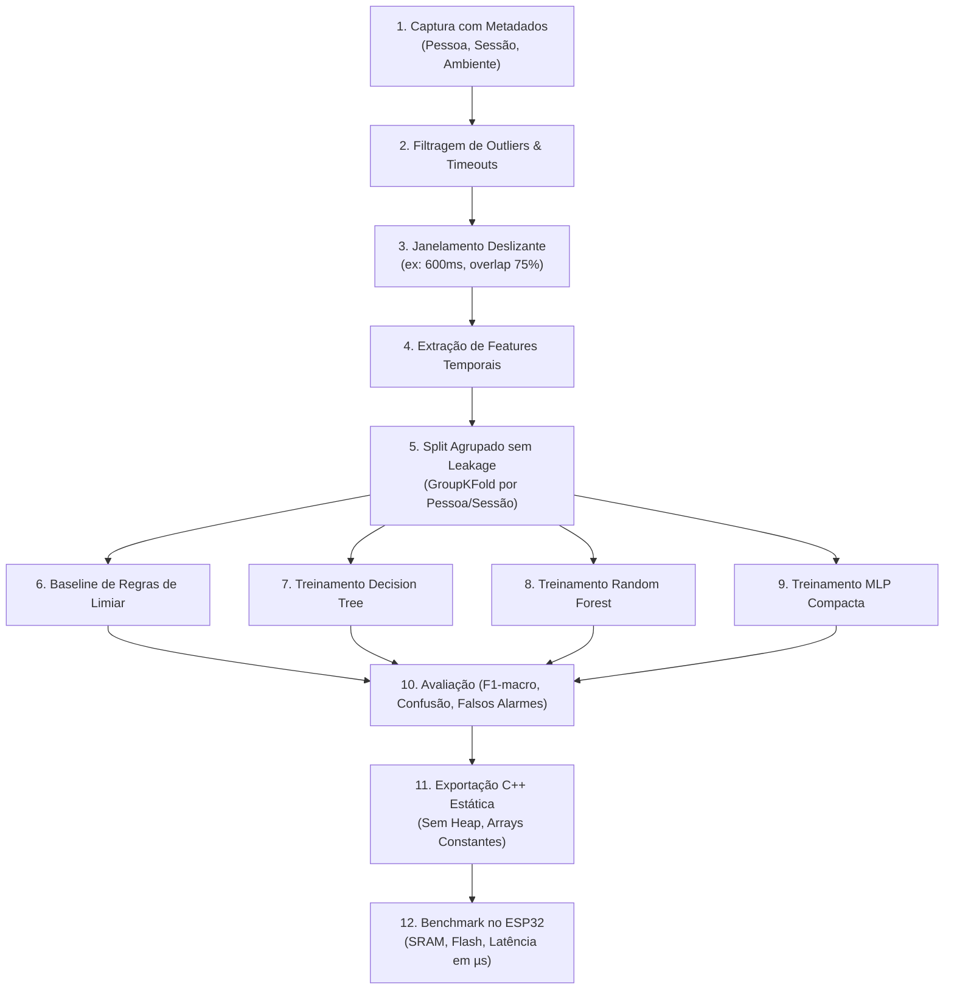

# Especificação do Pipeline de Machine Learning e TinyML — MotionPet

Este documento estabelece as diretrizes técnicas para o pipeline de aprendizado de máquina (Ciclo 2) e sua posterior conversão e embarque em TinyML no ESP32 (Ciclo 3 e Ciclo 5).

> [!IMPORTANT]
> **NOTA TÉCNICA E ÉTICA SOBRE VALIDAÇÃO E DADOS SINTÉTICOS**
>
> Geradores de dados sintéticos são ferramentas legítimas de engenharia de software destinadas **exclusivamente a verificar a integridade estrutural do pipeline de código** (formatos de entrada/saída, rotinas de pré-processamento, conversão para C++ e ausência de exceções).
> **Sob nenhuma hipótese dados sintéticos devem ser reportados como evidência de acurácia, precisão ou robustez de hardware**.
> Qualquer métrica definitiva de acurácia só é válida após a coleta sistemática de dados físicos reais na bancada com participantes humanos.

---

## 1. Fundamentos e Limitações Físicas do Sensor HC-SR04

O sensor ultrassônico HC-SR04 opera emitindo um trem de 8 pulsos de ultrassom a $40\text{ kHz}$ e medindo o tempo decorrido $\Delta t$ até o retorno da onda refletida (eco):

$$d = \frac{v_{som} \cdot \Delta t}{2} \approx \frac{343\text{ m/s} \cdot \Delta t}{2} = \frac{0,0343\text{ cm/\mu s} \cdot \Delta t}{2}$$

### 1.1 Restrições Críticas de Engenharia Acústica

1. **Dimensionalidade 1D (Escalar)**:
   - O sensor não possui matriz de feixes nem varredura angular. Ele mede estritamente uma distância escalar $d(t)$ até a superfície reflexiva mais próxima localizada dentro do seu cone de visão.
   - Não é possível discernir a posição angular $(x, y)$ ou a orientação da mão sem sensores adicionais; todo gesto é representado como uma série temporal unidimensional $d[n]$.
2. **Cone de Dispersão Acústica**:
   - O cone de emissão e recepção possui abertura angular efetiva de aproximadamente **$15^\circ$ a $20^\circ$**.
   - Objetos ou mãos posicionados fora desse cone deixam de produzir eco, gerando condição de *timeout*.
3. **Janela Mínima entre Disparos (Eco Residual e Reverberação)**:
   - Após a recepção do eco de um objeto próximo, a onda sonora continua se propagando e refletindo em paredes ou obstáculos ao fundo.
   - O fabricante recomenda um intervalo mínimo de **$50\text{ ms}$ a $60\text{ ms}$** entre ciclos consecutivos de disparo (`TRIG`).
   - Se um novo pulso for emitido antes desse tempo de decaimento, ecos residuais da medição anterior serão capturados erroneamente, causando leituras fantasmas.
4. **Taxa Máxima de Amostragem Efetiva ($f_s$)**:
   - Respeitando o intervalo seguro de $50\text{--}60\text{ ms}$, a taxa máxima de amostragem física é de **$16\text{ Hz}$ a $20\text{ Hz}$**.
   - Qualquer janela gestual de $600\text{ ms}$ conterá entre $10$ e $12$ amostras discretas de distância. O extrator de características deve ser projetado para extrair valor máximo desse conjunto compacto de pontos.

---

## 2. Taxonomia de Gestos e Classes Candidatas

```
       Distância
         ^
  (cm)   |
   40 +  |                     /-- RETREAT (Afastamento)
         |                    /
   25 +  |  -- HOLD -------  /
         |                  /
   10 +  |                 /
         | \              /
    2 +  |  \-- APPROACH /      -- NEUTRAL (Ausência de mão ou repouso)
         +------------------------------------------------------------> Tempo (ms)
           0       200     400     600     800     1000
```

### 2.1 Classes Iniciais de Ciclo 2
- **`APPROACH`**: Movimento deliberado de aproximação da mão em direção ao sensor na faixa de $35\text{ cm} \rightarrow 5\text{ cm}$. A derivada temporal da distância é predominantemente negativa: $\frac{\Delta d}{\Delta t} < -v_{th}$.
- **`RETREAT`**: Movimento de afastamento da mão do sensor na faixa de $5\text{ cm} \rightarrow 35\text{ cm}$. A derivada temporal é predominantemente positiva: $\frac{\Delta d}{\Delta t} > +v_{th}$.
- **`HOLD`**: Mão estática mantida na região central de interação ($10\text{ cm}$ a $25\text{ cm}$) por no mínimo $300\text{ ms}$. A variância da distância na janela é extremamente baixa: $\sigma^2 < \epsilon_{hold}$.
- **`NEUTRAL`**: Estado de repouso, ausência de obstáculos no cone acústico ($d > 40\text{ cm}$ ou *timeout*), ou variações térmicas e ruído ambiente de bancada.

### 2.2 Gestos Avançados de Ciclos Posteriores (Ciclos 3 e 5)
- **`IMPULSE`**: Movimento rápido de aproximação seguido imediatamente por recuo rápido dentro da mesma janela temporal (característico de arremesso ou disparo no mini-jogo *Pet Launch*).
- **`DOUBLE`**: Duplo movimento de aproximação-recuo em sequência (duplo clique aéreo para confirmações).

---

## 3. O Pipeline de 12 Etapas



### Etapa 1: Protocolo de Captura com Metadados
- Coleta de dados brutos gravados em arquivos CSV ou JSON Lines em `data/raw/`.
- Cada sessão deve registrar metadados de rastreabilidade:
  - `session_id`: identificador único da sessão.
  - `user_id`: identificador do voluntário/operador.
  - `timestamp_iso`: data e hora da coleta.
  - `target_gesture`: classe que o voluntário foi instruído a executar.
  - `ambient_notes`: temperatura aproximada, tipo de superfície refletora (mão aberta, mão fechada, luva, objeto plano).

### Etapa 2: Filtragem de Ruído, Outliers e Timeouts
- Substituição de leituras de *timeout* ($d = \text{null}$ ou $d > 400\text{ cm}$) por valor teto fixo de saturação ($d_{max} = 100\text{ cm}$) ou interpolação linear quando o dropout for isolado (1 amostra).
- Aplicação de filtro passa-baixa de mediana móvel de 3 amostras para suprimir reflexões espúrias pontuais antes do janelamento.

### Etapa 3: Janelamento Deslizante (*Sliding Window*)
- Janela de observação temporal de largura $W$: recomendada entre **$500\text{ ms}$ e $700\text{ ms}$** (correspondente a $10$ a $14$ amostras a $20\text{ Hz}$).
- Salto do janelamento (*stride*): $50\text{ ms}$ a $100\text{ ms}$ ($1$ a $2$ amostras), permitindo detecção ágil e baixa latência de resposta.

### Etapa 4: Extração de Features Temporais e Estatísticas
Para cada janela $D = [d_1, d_2, \dots, d_N]$ de $N$ amostras:
1. $d_{min} = \min(D)$ e $d_{max} = \max(D)$.
2. $\Delta d_{total} = d_N - d_1$ (amplitude de deslocamento total).
3. $\mu = \frac{1}{N}\sum_{i=1}^N d_i$ (distância média).
4. $\sigma = \sqrt{\frac{1}{N}\sum (d_i - \mu)^2}$ (desvio padrão / estabilidade).
5. $v_{media} = \frac{d_N - d_1}{t_N - t_1}$ (velocidade média de aproximação/afastamento).
6. $v_{pico} = \max_i \left|\frac{d_{i+1} - d_i}{\Delta t}\right|$ (velocidade instantânea máxima).
7. $N_{inversoes}$: quantidade de vezes que o sinal da derivada $\Delta d$ inverteu o sinal (discrimina movimentos oscilatórios de aproximações monotônicas).
8. $t_{val} / W$: posição relativa no tempo onde ocorreu o ponto mais próximo (vale de distância).

### Etapa 5: Particionamento Agrupado sem Vazamento (*Data Leakage*)
- **Proibição**: Nunca utilizar amostragem aleatória uniforme (*random train/test split*) sobre janelas deslizantes sobrepostas, pois janelas vizinhas compartilham mais de 80% dos dados brutos, resultando em sobreajuste artificial grave (*data leakage*).
- **Método**: Particionamento baseado em grupos (*GroupKFold* ou *Leave-One-Group-Out*), onde **todas as amostras de uma mesma sessão ou de uma mesma pessoa física residem exclusivamente no conjunto de treino ou no conjunto de teste**.

### Etapa 6: Modelo de Linha de Base (*Rule-Based Baseline*)
- Implementação de um classificador determinístico simples por regras de limiares:
  ```python
  if delta_d < -12.0 and v_media < -20.0:
      return "APPROACH"
  elif delta_d > 12.0 and v_media > 20.0:
      return "RETREAT"
  elif sigma < 1.5 and 8.0 <= media <= 25.0:
      return "HOLD"
  else:
      return "NEUTRAL"
  ```
- Este baseline serve como régua mínima de qualidade: qualquer modelo de ML ou TinyML mais complexo só se justifica se superar o baseline de regras de forma estatisticamente relevante.

### Etapa 7: Treinamento de Árvore de Decisão (*Decision Tree*)
- Modelo ideal para TinyML em microcontroladores de baixo custo:
  - Profundidade máxima restrita (`max_depth=4` ou `5`).
  - Mínimo de amostras por folha (`min_samples_leaf=5`) para evitar sobreajuste.
- Vantagem: tradução direta para um bloco compacto de instruções `if-else` em linguagem C/C++, sem necessidade de bibliotecas de álgebra linear.

### Etapa 8: Treinamento de Random Forest
- Conjunto de $10$ a $20$ árvores com profundidade rasa.
- Serve como modelo de referência em host para avaliar o teto de acurácia com ensemble antes de simplificar para o modelo final no microcontrolador.

### Etapa 9: MLP Compacta (*Multi-Layer Perceptron*)
- Rede neural rasa com topologia enxuta: Camada de entrada (ex: 8 features) $\rightarrow$ Camada Oculta (8 a 16 neurônios com ativação ReLU) $\rightarrow$ Camada de saída (4 classes com Softmax).
- Permite verificar a viabilidade de inferência com pesos quantizados em inteiros de 8 bits (int8) ou float32 nativo da FPU do ESP32.

### Etapa 10: Métricas Multivariadas de Avaliação
- **Métricas Primárias**:
  - **F1-Score Macro**: média balanceada do F1 entre todas as classes, impedindo que classes frequentes (`NEUTRAL`) mascarem desempenhos fracos em gestos dinâmicos (`APPROACH`).
  - **Matriz de Confusão Normalizada**: avaliação das taxas de confusão entre `HOLD` e `NEUTRAL`, ou entre falsas detecções de aproximação.
  - **Taxa de Falsos Alarmes em Repouso (*False Positive Rate on Neutral*)**: mede a probabilidade de o pet reagir a fantasmas quando o usuário não estiver gesticulando.

### Etapa 11: Exportação Estática para C++ (TinyML)
- Geração automatizada de código C++ limpo em arquivo de cabeçalho único (`firmware/gestures/tinyml_model.h`).
- **Requisitos de Código para o ESP32**:
  - Alocação $100\%$ estática: sem uso de `malloc`, `free`, `new` ou tipos dinâmicos como `std::vector` ou `std::string`.
  - Vetores de pesos e limiares gravados na memória Flash usando `const PROGMEM`.
  - Assinatura estrita: `GestureClass infer_gesture(const float features[NUM_FEATURES]);`.

### Etapa 12: Benchmark Embarcado no ESP32
- Medição prática de desempenho executada no hardware real:
  - **Pegada de Memória Flash**: incremento no binário final compilado (meta: $< 15\text{ kB}$).
  - **Pegada de Memória SRAM**: uso de memória de pilha e estática (meta: $< 2\text{ kB}$).
  - **Latência de Inferência**: tempo decorrido para processar a janela e retornar o resultado em microssegundos (meta: $< 1\text{ ms}$).
