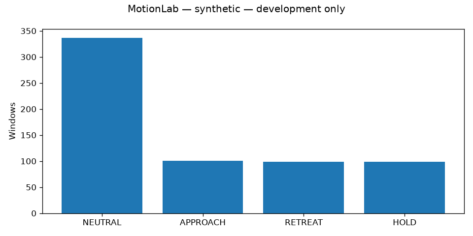
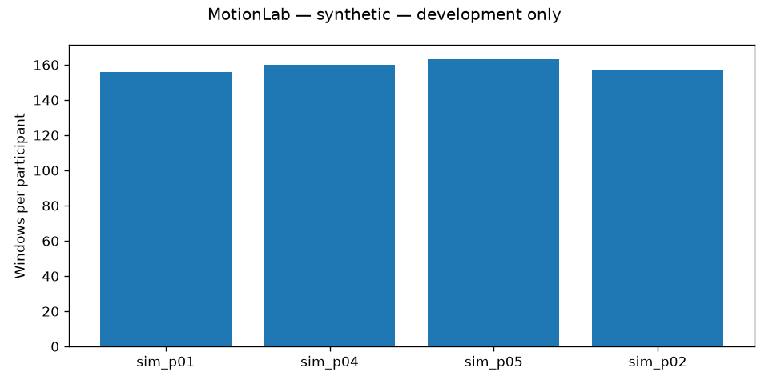
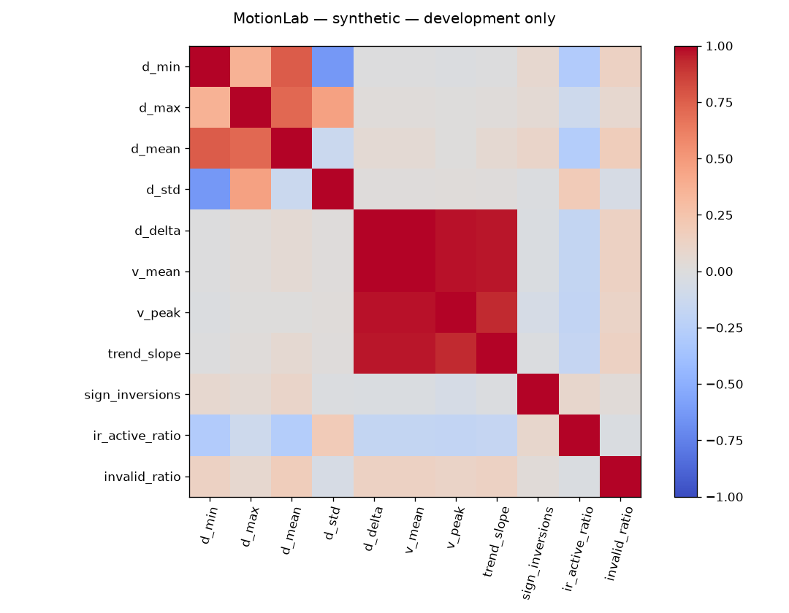
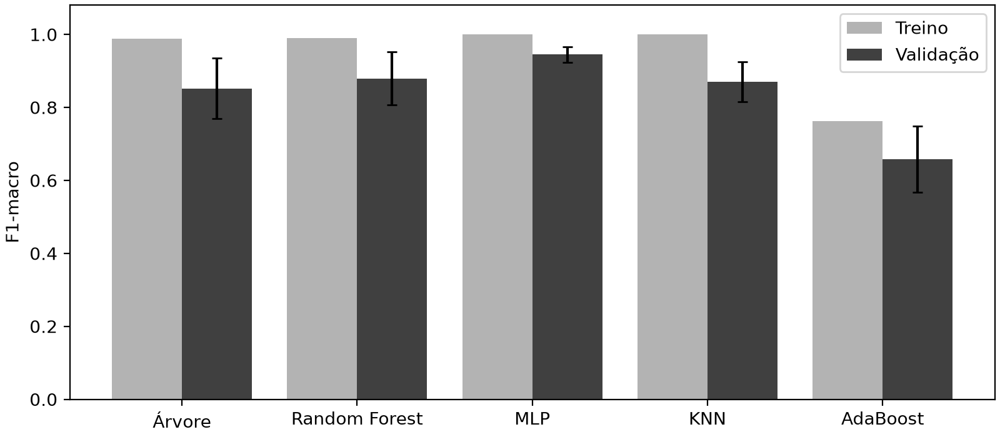
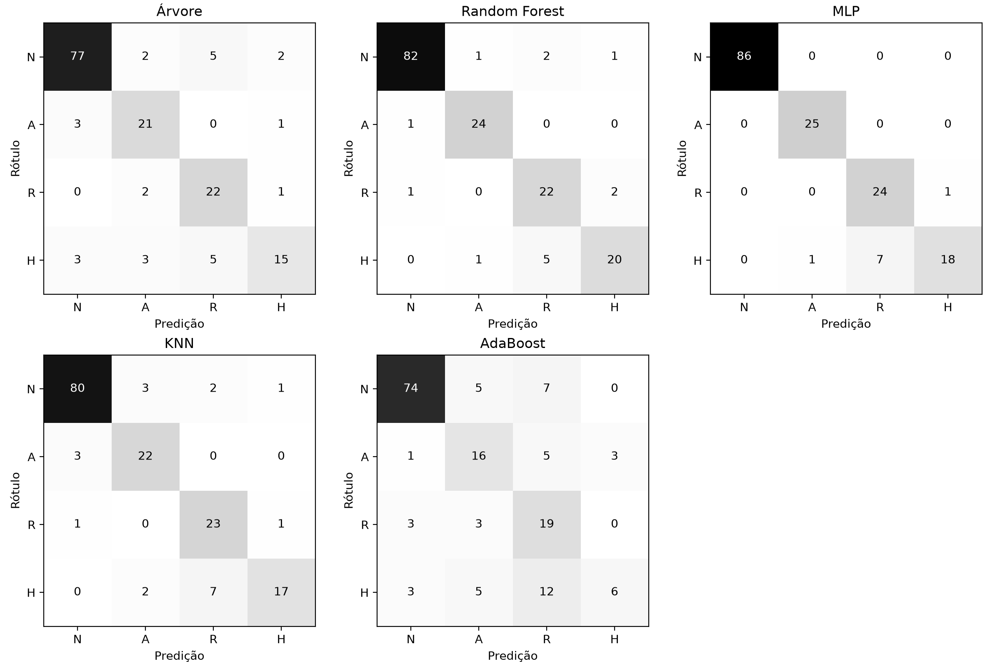

MotionLab Classificação de gestos e avaliação de um pipeline de aprendizado de máquina

João Henrique R. V. de Oliveira, Antônio Jose Paes de Andrade Junior, Marco Antônio Maciel, Jorge Dias, João Pedro

CESAR School – Grupo 5 – Recife, PE, Brasil

Abstract. MotionLab classifies four gestures from ultrasonic and infrared readings. We compare five models using grouped validation and an external holdout on simulated data. The compact MLP reaches a macro F1 of 0.9094 on 162 held-out windows. The experiment records model comparison and hyperparameter search in MLflow. These results assess the simulator and software; physical generalization remains unverified. The Docker demonstration passed integration and recovery checks.

Resumo. O MotionLab classifica quatro gestos com sinais de ultrassom e infravermelho. Comparamos cinco modelos por validação agrupada e teste externo em dados simulados. A MLP compacta alcançou F1-macro de 0,9094 em 162 janelas de teste. Comparação e busca de hiperparâmetros foram registradas no MLflow. Os resultados avaliam o simulador e o software; a generalização física permanece pendente. A demonstração Docker passou na integração e nos testes de recuperação.

## 1. Introdução e problema

Interfaces por gestos precisam distinguir aproximação, afastamento, permanência e ausência de ação sem provocar comandos indesejados. O MotionLab usa ESP32, HC-SR04 e TCRT5000 para reconhecer NEUTRAL, APPROACH, RETREAT e HOLD. Este trabalho avalia o pipeline de classificação e sua rastreabilidade, com atenção ao vazamento entre janelas sobrepostas e à diferença entre resultados simulados e desempenho físico [Grupo 5 2026a].

O escopo experimental é uma reprodução local após os merges dos três PRs de documentação, firmware e requisitos de AM, na revisão 51dd39d. Os dados são exclusivamente sintéticos. O ensaio anterior de transporte MQTT na bancada não fornece rótulos suficientes para validar os classificadores e não é usado como conjunto de teste.

## 2. Dados e análise exploratória

O corpus, gerado com seed 42, contém 1789 leituras, dez sessões e cinco participantes simulados. O pré-processamento produz 798 janelas com dez leituras e onze atributos de distância, velocidade, variabilidade, validade e presença IR. A unidade de separação é o participante. A EDA usa somente as 636 janelas dos quatro grupos de desenvolvimento; 162 janelas do quinto grupo permanecem reservadas para teste.

As cinco figuras foram geradas pelo experimento e incorporadas ao notebook executado. A predominância de NEUTRAL torna a acurácia isolada insuficiente; usamos F1-macro, que atribui o mesmo peso às quatro classes. Participantes simulados são variações do gerador, não voluntários humanos.

Figura 1. Janelas por classe no desenvolvimento

A Figura 1 mostra 337 janelas NEUTRAL e aproximadamente cem em cada gesto no desenvolvimento. A comparação deve considerar suporte por classe e erros de acionamento em NEUTRAL.

Figura 2. Janelas por participante simulado

A Figura 2 mostra entre 156 e 163 janelas por participante de desenvolvimento. Esse equilíbrio de contagens não comprova diversidade de movimentos reais; todos os grupos vêm do mesmo simulador.

Figura 3. Traço temporal de uma sessão simulada

A Figura 3 ilustra uma sessão e suas transições. O rótulo é definido pelo roteiro do gerador. A separação temporal entre movimentos ajuda a interpretar atributos de velocidade, mas não comprova que pessoas reproduzam essas trajetórias.

Figura 4. Fração de leituras inválidas por sessão

A Figura 4 mostra frações de leituras inválidas entre 2,3% e 7,2% nas sessões de desenvolvimento. Esse mecanismo exercita o tratamento de ausência de eco; perdas em sensores físicos podem ter outra distribuição.

Figura 5. Correlação dos onze atributos no desenvolvimento

A Figura 5 mostra correlação absoluta 1,000 entre v_mean e d_delta. A redundância sugere uma futura ablação de atributos, a ser decidida apenas no desenvolvimento. A correlação não demonstra causalidade nem justifica alteração após observar o teste.

## 3. Tratamento e protocolo de validação

Leituras sem eco ou fora da faixa física são marcadas como inválidas. O filtro causal mantém brevemente a última leitura válida e depois satura a distância; mediana móvel e EMA reduzem picos sem consultar amostras futuras. A fração de inválidas é preservada como atributo. Janelas com pureza de rótulo abaixo do limiar configurado são descartadas. Não se imputa a média global das sessões.

A separação determinística reserva sim_p03 para teste; sim_p01, sim_p04 e sim_p05 formam o treino e sim_p02 a validação. A busca usa os quatro grupos de desenvolvimento em GroupKFold. StandardScaler fica dentro dos pipelines de KNN e MLP e é ajustado no treino de cada fold. Nenhuma janela do participante de teste participa da EDA, da busca ou da escolha do modelo.

Executamos também LeaveOneGroupOut. Com quatro grupos e quatro folds, suas partições coincidem com GroupKFold, portanto não constituem duas evidências independentes. Leave-One-Out por janela colocaria leituras correlacionadas do mesmo participante em treino e validação. A CV reutilizada para escolher hiperparâmetros é descritiva e pode ser otimista; o holdout externo é a estimativa final deste corpus.

## 4. Baselines modelos e otimização

Uma árvore de profundidade 1 representa o baseline aprendido de baixa capacidade. Regras de domínio constituem uma referência adicional. A comparação inclui árvore de decisão, Random Forest, MLP compacta, KNN e AdaBoost. KNN e MLP usam padronização; modelos de árvores recebem atributos em sua escala original. KNN e AdaBoost são candidatos acadêmicos, mas o exportador embarcado cobre somente árvore, floresta e MLP.

Grid Search avaliou decision_tree: 12 combinações, random_forest: 27 combinações, mlp_compact: 9 combinações, knn: 10 combinações, adaboost: 9 combinações. O critério é F1-macro médio no GroupKFold, com menor diferença treino-validação como desempate. A busca da profundidade da árvore via --tune também foi executada antes da grade por família. Todos esses ajustes usam exclusivamente desenvolvimento.

decision_tree: dt_max_depth=9, dt_min_samples_leaf=1.

random_forest: rf_n_estimators=100, rf_max_depth=8, rf_min_samples_leaf=1.

mlp_compact: mlp_hidden_layers=[32, 16], mlp_alpha=0.001.

knn: knn_n_neighbors=5, knn_weights=distance.

adaboost: ada_n_estimators=50, ada_learning_rate=1.0.

## 5. Resultados e análise crítica

Os valores a seguir vêm dos artefatos evaluation.json e manifest.json da execução identificada na seção de reprodutibilidade. O desvio indicado é entre folds, não um intervalo de confiança. Os sete classificadores incluem os cinco modelos comparados e dois baselines.

rule_baseline: F1 CV 0.528 ± 0.013; F1 treino CV 0.529; F1 teste 0.5518.

decision_tree: F1 CV 0.852 ± 0.083; F1 treino CV 0.988; F1 teste 0.7856.

random_forest: F1 CV 0.879 ± 0.073; F1 treino CV 0.990; F1 teste 0.8843.

mlp_compact: F1 CV 0.945 ± 0.021; F1 treino CV 1.000; F1 teste 0.9094.

knn: F1 CV 0.870 ± 0.055; F1 treino CV 1.000; F1 teste 0.8375.

adaboost: F1 CV 0.658 ± 0.091; F1 treino CV 0.762; F1 teste 0.5951.

decision_stump_baseline: F1 CV 0.336 ± 0.016; F1 treino CV 0.339; F1 teste 0.3342.

Figura 6. F1 de treino e validação agrupada com desvio entre folds

As regras e o baseline de profundidade 1 têm desempenho baixo, compatível com capacidade insuficiente para este corpus. Árvore e floresta apresentam diferença treino-validação superior a 0,10. A MLP tem diferença menor e o melhor F1 no teste, mas isso não estabelece superioridade em pessoas reais. Para KNN com pesos por distância, o próprio exemplo é vizinho de si mesmo; F1 de treino 1,0 mede memorização e deve ser interpretado com cuidado. Os limiares de ajuste são convenções descritivas do projeto.

Figura 7. Matrizes de confusão do teste N neutro A aproximação R afastamento H permanência

As linhas representam o rótulo e as colunas a predição. A MLP acerta as 86 janelas NEUTRAL e as 25 APPROACH; em HOLD, acerta 18 de 26 e confunde sete com RETREAT. Assim, mesmo o melhor resultado agregado conserva uma fragilidade específica em permanência. AdaBoost acerta apenas seis de 26 HOLD. A prioridade de coleta real é verificar permanência e transições, além de acionar o sistema em períodos longos sem gesto.

O selecionador embarcado escolheu mlp_compact por critérios na validação, sem consultar o holdout. A exportação estimou 4.264 bytes de flash e 352 bytes de pilha de trabalho do modelo; esses números não representam a memória total do firmware. A verificação nativa comparou 162 janelas Python/C++, com concordância de classes de 100%. A execução ocorreu no computador; latência e memória na ESP32 continuam sem medição nesta revisão.

## 6. Arquitetura rastreabilidade e reprodução

A arquitetura prevista é ESP32 ou simulador → MQTT → persistência → Airflow → MLflow → publicação explícita → API → Motion Intelligence. O consumidor do pipeline persiste JSONL rotulado; a ingestão IoT mantém SQLite separado. --watch-iot-db permite exibir telemetria física na API sem transformar dados sem rótulos em treino ou holdout. O dashboard identifica origem e estado de validação [Grupo 5 2026b].

O DAG possui configuração, preparação com snapshot, experimento e publicação. O Compose principal executa o DAG em lote; o perfil console oferece a interface do Airflow. Não há promoção implícita de latest. Nesta revisão, a configuração e o build do Compose passaram, e a stack foi iniciada com docker compose up --build -d. O DAG concluiu as quatro tarefas em 23,50 s; a tarefa experiment, que inclui busca, treino e registro no MLflow, levou 20,77 s sob o orçamento configurado de 1 CPU e 1,4 GB. O tempo exclusivo da grade não foi instrumentado. O verificador --faults aprovou 14 checks, incluindo novas mensagens MQTT, deduplicação, inferência, proxy do dashboard e recuperação após reinícios de consumidor, broker, API e MLflow. Capturas das quatro interfaces estão nas evidências.

A reprodução local concluiu dois experimentos MLflow: MotionLab-synthetic para comparação e MotionLab-synthetic-hiperparametros para a busca. Foram registrados parâmetros, métricas, modelos e artefatos. O notebook foi regenerado com as saídas da execução. A suíte final passou em 669 testes, com cinco pulados, e a interface passou em 20 testes. Testes de software não substituem a aceitação da demonstração integrada.

A execução usa Python 3.12.14 e dependências fixadas em requirements.txt e requirements-mlops.lock. Os artefatos locais estão em data/experiments/synthetic/20261116T021459_3b94f6f7. O hash do corpus é 2e99f546ad6f0b6af65e05b782cd1ba631e369b2e718772b32a88969a81a1d75. Manifesto, avaliação, logs e versões estão copiados para docs/evidencias/am-2026-11-15. O notebook e este relatório preservam as métricas mesmo sem o diretório de execução ignorado pelo Git.

## 7. Limitações e próximos experimentos

Um participante simulado de teste não sustenta inferências sobre a população de usuários. Janelas sobrepostas reduzem a independência das observações e o gerador pode simplificar transições, ruídos e variação entre pessoas. O resultado obtido valida a implementação e estabelece uma referência sintética; não mede desempenho físico. A validação cruzada após tuning não é uma avaliação aninhada.

A próxima campanha deve seguir o guia de coleta, com autorização dos participantes, identificação de origem, várias sessões e registro de condições. O grupo deve reservar participantes reais antes de explorar os dados, congelar o protocolo e avaliar a coorte real separadamente. Recomenda-se analisar F1 por classe, falsos acionamentos em NEUTRAL, eventos e latência em períodos sem gesto, com ablação de atributos feita apenas no desenvolvimento.

A integração Docker foi validada com dados de demonstração em uma coorte independente do experimento sintético analisado acima. A MLP publicada pela stack obteve F1-macro de 0,966 em 80 janelas reservadas DEMO; esse valor não substitui o teste sintético de 162 janelas nem constitui validação física. Ainda faltam validar as ações com o modelo na placa e confirmar com o professor a aceitação do dashboard próprio e da organização por índices. O limite de páginas e a especificação integral de AM devem ser conferidos pelo grupo antes da submissão. Não há garantia de nota a partir da implementação ou dos testes.

## 8. Conclusão

O MotionLab oferece comparação de cinco famílias, baselines, busca agrupada, holdout por participante, rastreabilidade e exportação nativa verificada. No corpus sintético reproduzido, a MLP atingiu F1-macro de 0,9094 e apresentou maior dificuldade em HOLD. A entrega acadêmica precisa combinar essas evidências com demonstração operacional, revisão humana do relatório e avaliação real para sustentar alegações de uso físico.

## Declaração de uso de inteligência artificial

Ferramentas de IA auxiliaram a revisão do repositório, a execução de verificações e a redação deste texto. Os nomes e papéis foram mantidos conforme o README do grupo. Os resultados apresentados foram extraídos dos artefatos executados. Cabe aos integrantes revisar a redação e as conclusões, confirmar a autoria e adequar esta declaração à exigência da disciplina antes da submissão.

## Referências

Grupo 5 (2026a). MotionLab. Código e documentação na revisão 51dd39d. Repositório ChickenLittle, README e docs/aprendizado_maquina.md. https://github.com/jhrvo0/ChickenLittle.

Grupo 5 (2026b). Contrato da API e operação de ML/MLOps. docs/motionlab_ml_api.md, docs/motionlab_mlops.md e docs/real_data_collection_guide.md. Repositório ChickenLittle.

Grupo 5 (2026c). Experimento sintético 20261116T021459_3b94f6f7. Manifesto, avaliação, logs e notebook executado. docs/evidencias/am-2026-11-15 e notebooks/motionlab_bootstrap.ipynb.
