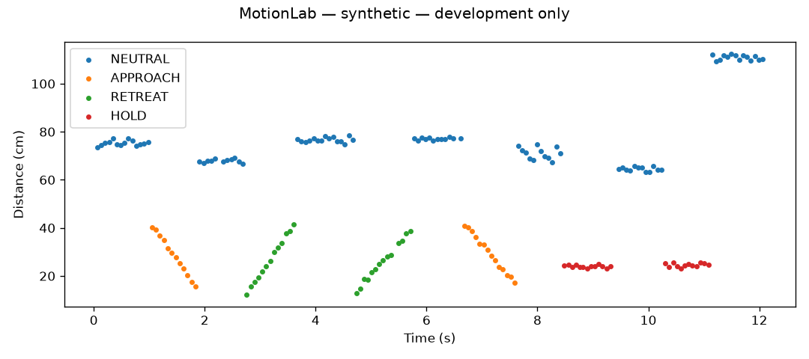
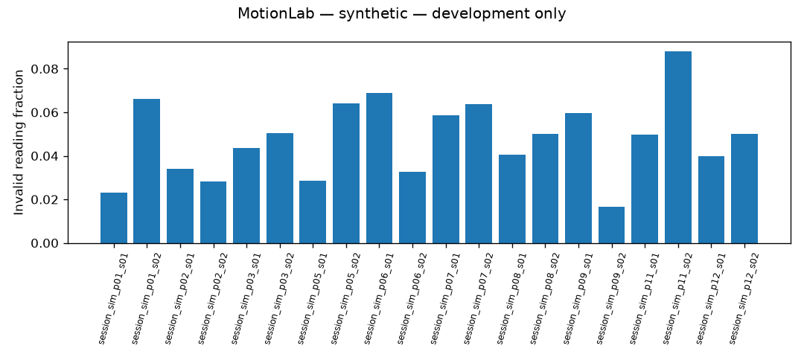
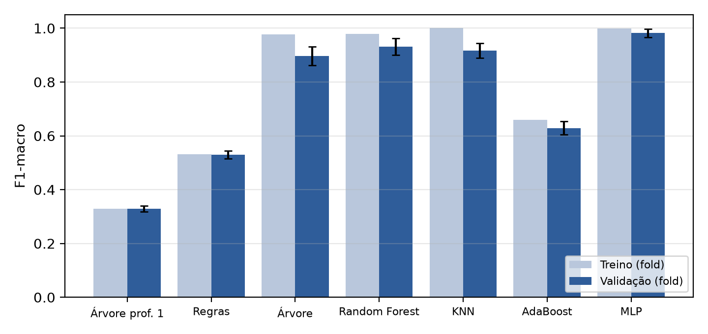
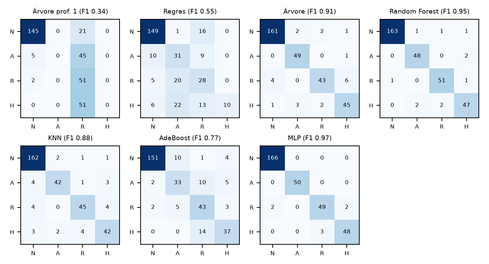

# MotionLab: classificação de gestos sem contato com validação agrupada e MLOps

João Henrique R. V. de Oliveira, Antônio Jose Paes de Andrade Junior, Marco Antônio Maciel, Jorge Dias, João Pedro

CESAR School – Grupo 5 – Recife, PE, Brasil

**Abstract.** MotionLab classifies four hand gestures from ultrasonic and infrared readings acquired by an ESP32. Using a simulated bootstrap corpus of twelve participants, we compare five model families against two baselines with participant-grouped validation, hyperparameter search and an external holdout of two participants. The compact MLP reached a macro F1 of 0.970 on 320 held-out windows and was significantly better than every other model in a Friedman test with Holm-corrected Wilcoxon comparisons. Experiments, models and artifacts are tracked in MLflow, orchestrated by Airflow and served by an API in a Docker Compose stack. Results characterize the simulator; physical performance remains to be measured.

**Resumo.** O MotionLab classifica quatro gestos a partir de leituras de ultrassom e infravermelho adquiridas por uma ESP32. Com um corpus bootstrap simulado de doze participantes, comparamos cinco famílias de modelos e dois baselines com validação agrupada por participante, busca de hiperparâmetros e teste externo com dois participantes. A MLP compacta obteve F1-macro de 0,970 em 320 janelas de teste e superou todos os demais modelos no teste de Friedman com comparações de Wilcoxon corrigidas por Holm. Experimentos, modelos e artefatos são rastreados no MLflow, orquestrados pelo Airflow e servidos por API em Docker Compose. Os resultados caracterizam o simulador; o desempenho físico ainda será medido.

## 1. Introdução

Interfaces por gestos sem contato precisam distinguir aproximação, afastamento, permanência e ausência de ação sem disparar comandos indesejados. O MotionLab usa uma ESP32 com um sensor ultrassônico HC-SR04 e um sensor infravermelho TCRT5000, lidos a cada 70 ms, para reconhecer quatro classes: NEUTRAL, APPROACH, RETREAT e HOLD. As leituras seguem por USB para o dashboard local e por MQTT para o pipeline de dados.

Este trabalho descreve a solução de aprendizado de máquina: análise exploratória do corpus bootstrap, tratamento dos dados, protocolo de validação sem vazamento entre janelas sobrepostas, comparação de modelos com análise estatística e a integração com MLflow, Airflow, API e Docker. A principal preocupação metodológica é que janelas consecutivas da mesma pessoa são quase idênticas; por isso toda separação é feita por participante.

## 2. Dados e análise exploratória

O corpus bootstrap foi gerado pelo simulador do projeto com semente 42: 4303 leituras de doze participantes simulados, duas sessões cada, no mesmo período de 70 ms do firmware. Cada participante tem um deslocamento de distância e uma velocidade próprios, de modo que os grupos não são idênticos. As leituras são agrupadas em janelas de dez amostras com passo de duas, totalizando 1918 janelas e onze atributos: distâncias mínima, máxima, média e desvio, variação total, velocidades média e de pico, inclinação, inversões de sentido, fração de detecções IR e fração de leituras inválidas.

Antes de qualquer análise, os participantes sim_p04 e sim_p10 foram reservados para teste. A EDA usa apenas as 1598 janelas dos dez participantes de desenvolvimento. A Tabela 1 resume os atributos nesse conjunto.

**Tabela 1. Estatísticas descritivas dos atributos nas janelas de desenvolvimento**

| Atributo | Média | Desvio | Mínimo | Mediana | Máximo |
|---|---|---|---|---|---|
| d_min | 35,44 | 24,60 | 10,26 | 23,10 | 100,00 |
| d_max | 73,97 | 21,07 | 13,06 | 77,23 | 100,00 |
| d_mean | 55,34 | 22,97 | 12,63 | 55,56 | 100,00 |
| d_std | 14,23 | 10,72 | 0,00 | 13,53 | 39,91 |
| d_delta | -0,21 | 44,69 | -87,20 | 0,44 | 88,93 |
| v_mean | -0,29 | 70,94 | -138,42 | 0,70 | 142,97 |
| v_peak | 1,90 | 434,27 | -843,40 | 6,11 | 825,83 |
| trend_slope | -0,29 | 74,26 | -182,73 | 0,47 | 176,42 |
| sign_inversions | 0,39 | 0,62 | 0,00 | 0,00 | 3,00 |
| ir_active_ratio | 0,02 | 0,08 | 0,00 | 0,00 | 0,90 |
| invalid_ratio | 0,05 | 0,07 | 0,00 | 0,00 | 0,30 |

As distâncias ficam limitadas a 100 cm pela saturação do filtro. As velocidades instantâneas têm caudas largas (até 843,40 cm/s em módulo), em parte por saltos entre uma leitura válida e a saturação de 100 cm, o que motiva padronizar os atributos nos modelos sensíveis à escala. A fração de detecções IR é quase sempre zero, porque o sensor só responde abaixo de cerca de 13 cm.

**Figura 1. Janelas por classe no desenvolvimento**

A Figura 1 mostra 845 janelas NEUTRAL e entre 242 e 257 em cada gesto. Como NEUTRAL domina, a acurácia isolada é enganosa; a métrica principal é o F1-macro, que dá o mesmo peso às quatro classes, complementada pela taxa de falsos acionamentos em NEUTRAL.

**Figura 2. Janelas por participante simulado no desenvolvimento**

A Figura 2 mostra contagens semelhantes entre participantes. O equilíbrio facilita a validação agrupada, mas não demonstra diversidade de movimentos reais, já que todos os grupos vêm do mesmo gerador.

**Figura 3. Traço temporal de uma sessão simulada com os rótulos do roteiro**

A Figura 3 ilustra uma sessão: períodos NEUTRAL distantes intercalados com gestos na zona ativa. As transições entre gestos explicam por que janelas com rótulo misto precisam ser tratadas.

**Figura 4. Fração de leituras inválidas por sessão**

A Figura 4 mostra entre 1,7% e 8,8% de leituras sem eco por sessão, mais frequentes em NEUTRAL distante. Perdas em sensores físicos podem ter outra distribuição; esta é uma das hipóteses a verificar na coleta real.

**Figura 5. Correlação entre os onze atributos no desenvolvimento**

A Figura 5 mostra correlação absoluta igual a 1,0 entre velocidade média e variação total, que são proporcionais numa janela de duração fixa. A redundância não prejudica árvores e MLP, mas indica uma ablação de atributos como trabalho futuro, decidida apenas no desenvolvimento.

## 3. Tratamento dos dados e protocolo de validação

Leituras sem eco ou fora de 2 a 400 cm são tratadas como ausentes. Não imputamos médias do corpus: isso usaria informação de outras sessões e não seria reproduzível na ESP32. Um filtro causal repete o último valor válido por até duas amostras e depois satura em 100 cm; mediana móvel de três amostras remove picos e uma média exponencial suaviza o sinal. A fração de inválidas vira atributo. Janelas cuja classe dominante cobre menos de 60% das amostras são descartadas. O IR booleano entra como fração e as classes são codificadas por índice. KNN e MLP usam StandardScaler dentro de um pipeline ajustado só no treino de cada fold; modelos de árvore usam os atributos originais.

A divisão é feita por participante: 7 para treino, 3 para validação e 2 para teste. A validação cruzada usa StratifiedGroupKFold com cinco folds, que mantém cada participante inteiro em um fold e equilibra a proporção das classes [Roberts et al. 2017]. Também executamos LeaveOneGroupOut, com dez folds, um por participante de desenvolvimento. Leave-One-Out por janela não é aplicável: colocaria janelas quase idênticas da mesma pessoa em treino e validação. O teste externo não participa de EDA, busca nem seleção.

## 4. Modelos e otimização de hiperparâmetros

O baseline aprendido é uma árvore de profundidade 1, de baixa capacidade, escolhida por ser o classificador mais simples que usa os mesmos atributos. Regras de domínio, sem treino, servem de referência adicional. Comparamos cinco famílias: árvore de decisão, Random Forest [Breiman 2001], AdaBoost com árvores de profundidade 1 [Freund e Schapire 1997], KNN [Cover e Hart 1967] e MLP, todas em scikit-learn [Pedregosa et al. 2011].

Os hiperparâmetros foram escolhidos por Grid Search em cada família, com a mesma validação cruzada agrupada do desenvolvimento e F1-macro médio como critério; em empate vence a menor diferença treino-validação. Os espaços são pequenos de propósito, porque o pipeline roda dentro do Airflow com uma CPU e o modelo escolhido precisa caber na ESP32. A Tabela 2 resume a busca, com 67 combinações no total.

**Tabela 2. Grid Search por família de modelo (F1-macro médio na validação cruzada)**

| Família | Combinações | Melhor configuração | F1 CV |
|---|---|---|---|
| Árvore de decisão | 12 | profundidade 9; mín. folha 1 | 0,897 |
| Random Forest | 27 | árvores 100; profundidade 8; mín. folha 1 | 0,932 |
| KNN | 10 | k 3; pesos distância | 0,917 |
| AdaBoost | 9 | estimadores 50; taxa 1 | 0,629 |
| MLP | 9 | camadas 32×16; alpha 0,01 | 0,982 |

A seleção na mesma validação cruzada que mede o desempenho é otimista [Cawley e Talbot 2010; Varma e Simon 2006]. Por isso o teste externo, nunca usado nas escolhas, é a estimativa final.

## 5. Resultados e análise crítica

A Tabela 3 reúne, para cada modelo, o F1 de treino e de validação nos folds, o F1 no LeaveOneGroupOut e o desempenho no teste externo. O desvio é entre folds, não um intervalo de confiança.

**Tabela 3. F1-macro por modelo na validação agrupada e no teste externo**

| Modelo | Treino | SGKF (5) | LOGO (10) | Teste | FAR |
|---|---|---|---|---|---|
| Árvore prof. 1 (baseline) | 0,330 | 0,329 ± 0,011 | 0,328 ± 0,014 | 0,343 | 12,7% |
| Regras (referência) | 0,531 | 0,530 ± 0,014 | 0,529 ± 0,024 | 0,546 | 10,2% |
| Árvore de decisão | 0,976 | 0,897 ± 0,035 | 0,895 ± 0,050 | 0,909 | 3,0% |
| Random Forest | 0,979 | 0,932 ± 0,031 | 0,933 ± 0,043 | 0,953 | 1,8% |
| KNN | 1,000 | 0,917 ± 0,027 | 0,921 ± 0,034 | 0,882 | 2,4% |
| AdaBoost | 0,660 | 0,629 ± 0,024 | 0,642 ± 0,050 | 0,766 | 9,0% |
| MLP | 0,999 | 0,982 ± 0,016 | 0,983 ± 0,018 | 0,970 | 0,0% |

**Figura 6. F1-macro de treino e de validação por modelo, com desvio entre folds**

Os baselines ficam abaixo de 0,55, sem diferença entre treino e validação: faltam capacidade e atributos de sequência ao stump e às regras fixas, o que caracteriza subajuste. Árvore, KNN e Random Forest apresentam diferença treino-validação entre 0,047 e 0,083, abaixo do limiar de 0,10 que adotamos para sobreajuste: o modelo ajusta melhor o treino, mas a validação continua alta. No KNN com pesos por distância, o F1 de treino igual a 1 é esperado, pois cada exemplo é vizinho de si mesmo. AdaBoost com árvores rasas fica limitado em 0,629. A MLP tem o maior F1 de validação e a menor diferença treino-validação entre os modelos fortes.

Para verificar se as diferenças vão além da variação entre folds, aplicamos o teste de Friedman aos dez folds do LeaveOneGroupOut e, em seguida, Wilcoxon pareado entre o melhor modelo e cada outro, com correção de Holm [Demšar 2006; Holm 1979]. O Friedman rejeitou a igualdade dos modelos (estatística 57,81; p = 1,2 × 10⁻¹⁰). A MLP teve posto médio 1,00 e superou cada outro modelo com p corrigido de 0,012; esse valor é o mesmo em todas as comparações porque, com dez folds e a MLP melhor em todos, o Wilcoxon atinge seu menor p possível. Os folds compartilham dados de treino, então o teste indica tendência e não independência estrita.

**Figura 7. Matrizes de confusão no teste externo (linhas: rótulo; colunas: previsão; N neutro, A aproximação, R afastamento, H permanência)**

No teste externo, com 320 janelas de dois participantes nunca vistos, a MLP obteve F1-macro 0,970, acurácia 97,8% e nenhum falso acionamento em NEUTRAL. Os erros restantes estão entre RETREAT e HOLD: 2 afastamentos foram lidos como permanência e 3 permanências como afastamento, além de 2 afastamentos classificados como neutros. Isso é coerente com o fim de um afastamento lento, em que a distância quase não varia. As regras confundem principalmente HOLD com APPROACH, o que explica seu F1 baixo.

O seletor do modelo embarcado escolheu a MLP pela validação, sem consultar o teste. A exportação em C++ estimou 4.264 bytes de flash e 352 bytes de pilha, e a execução nativa reproduziu as classes do Python em 320 de 320 janelas do teste. Latência e memória na própria ESP32 ainda não foram medidas.

## 6. Arquitetura, MLOps e reprodutibilidade

A ESP32, ou o simulador, publica as amostras por MQTT no broker Mosquitto. Um consumidor valida e persiste as sessões rotuladas em JSONL e a telemetria por amostra em SQLite, com deduplicação. O DAG do Airflow executa quatro tarefas: configuração, preparação com snapshot e validação do corpus, experimento (busca, treino, avaliação e registro) e publicação explícita do modelo. A API de inferência observa novos dados, gera previsões e as expõe ao dashboard MotionLab, que mostra sinais ao vivo, métricas dos modelos, previsões e o estado dos serviços, sempre com a origem do dado.

O MLflow [Zaharia et al. 2018] registra dois experimentos: um com os sete modelos, com parâmetros, métricas, modelo salvo e artefatos, e outro com cada combinação do Grid Search. Toda a solução sobe com um único comando, docker compose up --build, que inicia broker, simulador, ingestão, Airflow, MLflow, API e dashboard. Um verificador automático testa a stack de ponta a ponta, incluindo novas mensagens MQTT, deduplicação, inferência e recuperação após reinício de cada serviço.

O experimento deste relatório é o 20261116T230322_c96f733d, com hash de corpus 1160ac1966956fde. Manifesto, avaliação, notebook executado e o script que gera estas figuras e tabelas estão no repositório [Grupo 5 2026].

## 7. Limitações e trabalhos futuros

Todos os dados são simulados. O gerador reproduz trajetórias idealizadas, com pouca variação entre pessoas, e os resultados acima indicam que a tarefa é fácil para o simulador, não que o sistema funcione assim com usuários reais. Janelas sobrepostas reduzem a independência das observações e dois participantes de teste ainda são poucos. A busca de hiperparâmetros não usa validação aninhada.

O próximo passo é coletar participantes reais com o guia de coleta do projeto, reservando os participantes de teste antes de explorar os dados e avaliando a coorte real separadamente. As métricas prioritárias são o F1 em HOLD e RETREAT, os falsos acionamentos em períodos longos sem gesto e a latência na ESP32. A ablação dos atributos redundantes também fica para essa etapa.

## 8. Conclusão

O MotionLab integra aquisição por sistema embarcado, MQTT, persistência, Airflow, MLflow, API, dashboard e Docker em um pipeline reprodutível. Com validação agrupada por participante, Grid Search e teste estatístico, a MLP foi o melhor modelo no corpus simulado e roda em C++ com o mesmo resultado do Python. A validação com usuários reais é a etapa que falta para sustentar o uso físico.

## Declaração de uso de inteligência artificial

Ferramentas de IA auxiliaram na revisão do código, na execução das verificações e na redação deste texto, com autorização do professor informada pelo representante do grupo. Os resultados vêm dos artefatos executados e citados. Os integrantes revisaram o conteúdo e respondem por ele.

## Referências

- Breiman, L. (2001). Random forests. Machine Learning, 45(1):5–32.
- Cawley, G. C. e Talbot, N. L. C. (2010). On over-fitting in model selection and subsequent selection bias in performance evaluation. Journal of Machine Learning Research, 11:2079–2107.
- Cover, T. e Hart, P. (1967). Nearest neighbor pattern classification. IEEE Transactions on Information Theory, 13(1):21–27.
- Demšar, J. (2006). Statistical comparisons of classifiers over multiple data sets. Journal of Machine Learning Research, 7:1–30.
- Freund, Y. e Schapire, R. E. (1997). A decision-theoretic generalization of on-line learning and an application to boosting. Journal of Computer and System Sciences, 55(1):119–139.
- Grupo 5 (2026). MotionLab: repositório ChickenLittle. https://github.com/jhrvo0/ChickenLittle.
- Holm, S. (1979). A simple sequentially rejective multiple test procedure. Scandinavian Journal of Statistics, 6(2):65–70.
- Pedregosa, F. et al. (2011). Scikit-learn: machine learning in Python. Journal of Machine Learning Research, 12:2825–2830.
- Roberts, D. R. et al. (2017). Cross-validation strategies for data with temporal, spatial, hierarchical, or phylogenetic structure. Ecography, 40(8):913–929.
- Varma, S. e Simon, R. (2006). Bias in error estimation when using cross-validation for model selection. BMC Bioinformatics, 7:91.
- Zaharia, M. et al. (2018). Accelerating the machine learning lifecycle with MLflow. IEEE Data Engineering Bulletin, 41(4):39–45.
